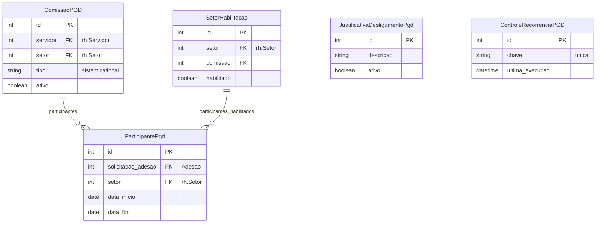

# Modelo de dados — Gestão/Comissão

> ERD das entidades de gestão e comissão do PGD (models herdam `ModelPlus` de `djtools.db`).
> FKs para entidades de outras áreas aparecem como **externas**.
> Termos: ver [Glossário](../GLOSSARIO.md).

## Entidades

| Entidade | Descrição | Relações-chave |
|---|---|---|
| `ComissaoPGD` | Membro da comissão de gestão do PGD | FK `servidor`, FK `setor` (rh); tipo: sistêmica/local |
| `ParticipantePgd` | Vínculo servidor-setor como participante ativo | FK `solicitacao_adesao`, FK `setor` (rh) |
| `SetorHabilitacao` | Habilitação de setor para participação no PGD | FK `setor` (rh), FK `comissao` |
| `JustificativaDesligamentoPgd` | Catálogo de justificativas para desligamento | — |
| `ControleRecorrenciaPGD` | Controle de execução de tarefas recorrentes | Chave única |

## Entidades externas referenciadas

| Entidade | Módulo/área de origem |
|---|---|
| `Servidor` | `rh` |
| `Setor` | `rh` |
| `SolicitacaoAdesaoServidor` | Adesão (mesmo módulo) |

---
_Gerado/atualizado via subagent `documentador` em 2026-06-04.
