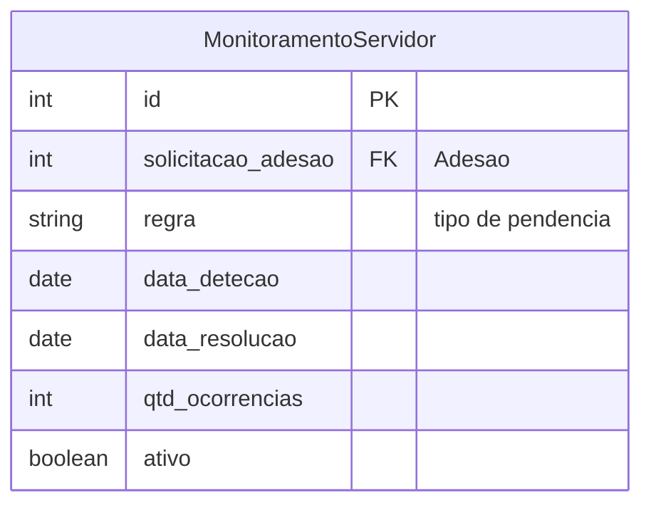

# Modelo de dados — Monitoramento

> ERD das entidades de monitoramento do PGD (models herdam `ModelPlus` de `djtools.db`).
> Termos: ver [Glossário](../GLOSSARIO.md).

## Entidades

| Entidade | Descrição | Relações-chave |
|---|---|---|
| `MonitoramentoServidor` | Regra/estado de monitoramento de um servidor | FK `solicitacao_adesao`; registra pendências e ocorrências |

## Entidades externas referenciadas

| Entidade | Módulo/área de origem |
|---|---|
| `SolicitacaoAdesaoServidor` | Adesão (mesmo módulo) |

---
_Gerado/atualizado via subagent `documentador` em 2026-06-04.
