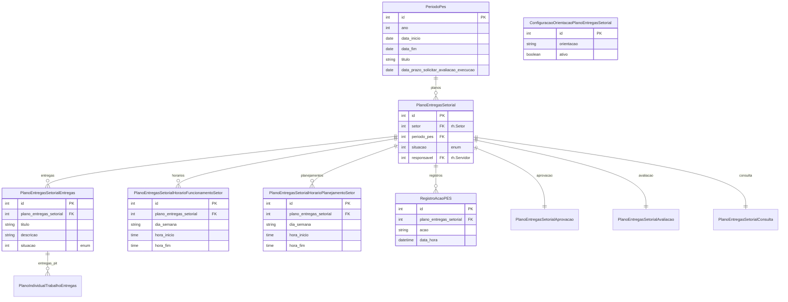

# Modelo de dados — PES (Plano de Entregas Setorial)

> ERD das entidades de PES (models herdam `ModelPlus` de `djtools.db`).
> FKs para entidades de outras áreas aparecem como **externas**.
> Termos: ver [Glossário](../GLOSSARIO.md).

## Entidades

| Entidade | Descrição | Relações-chave |
|---|---|---|
| `PeriodoPes` | Período de referência do PES (ex.: 2024.1) | 1:N com `PlanoEntregasSetorial` |
| `PlanoEntregasSetorial` | Plano de entregas do setor | FK `setor` (rh), FK `periodo_pes` |
| `PlanoEntregasSetorialAprovacao` | Herda PES; proxy para aprovação | Herda `PlanoEntregasSetorial` |
| `PlanoEntregasSetorialAvaliacao` | Herda PES; proxy para avaliação | Herda `PlanoEntregasSetorial` |
| `PlanoEntregasSetorialConsulta` | Herda PES; proxy para consulta | Herda `PlanoEntregasSetorial` |
| `PlanoEntregasSetorialEntregas` | Entrega definida no PES | FK `plano_entregas_setorial` |
| `PlanoEntregasSetorialHorarioFuncionamentoSetor` | Horário de funcionamento do setor no PES | FK `plano_entregas_setorial` |
| `PlanoEntregasSetorialHorarioPlanejamentoSetor` | Horário de planejamento do setor no PES | FK `plano_entregas_setorial` |
| `ConfiguracaoOrientacaoPlanoEntregasSetorial` | Orientações/configuração para elaboração do PES | Singleton |
| `RegistroAcaoPES` | Log de ações no PES | Herda `RegistroAcaoPGD` |

## Entidades externas referenciadas

| Entidade | Módulo/área de origem |
|---|---|
| `Setor` | `rh` |
| `Servidor` | `rh` |
| `PlanoIndividualTrabalhoEntregas` | PIT (mesmo módulo) |

---
_Gerado/atualizado via subagent `documentador` em 2026-06-04.
