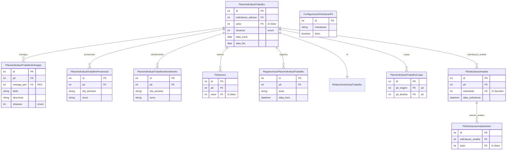

# Modelo de dados — PIT (Plano Individual de Trabalho)

> ERD das entidades de PIT (models herdam `ModelPlus` de `djtools.db`).
> FKs para entidades de outras áreas aparecem como **externas**.
> Termos: ver [Glossário](../GLOSSARIO.md).

## Entidades

| Entidade | Descrição | Relações-chave |
|---|---|---|
| `PlanoIndividualTrabalho` | PIT — plano do servidor, principal entidade do ciclo | FK `solicitacao_adesao`; 1:N com entregas, presencial, atendimento |
| `PlanoIndividualTrabalhoEntregas` | Entrega vinculada ao PIT, opcionalmente ligada a entrega do PES | FK `pit`; FK opcional `entrega_pes` |
| `PlanoIndividualTrabalhoPresencial` | Registro de dia/horário de trabalho presencial | FK `pit` |
| `PlanoIndividualTrabalhoAtendimento` | Registro de dia/horário de teletrabalho/atendimento | FK `pit` |
| `PitSetores` | Setores adicionais onde o servidor atua no PIT | FK `pit`, FK `setor` (rh) |
| `PlanoIndividualTrabalhoCopia` | Relação de cópia entre PITs (reaproveitamento) | FK `pit_origem`, FK `pit_destino` |
| `PitSolicitacaoAnalise` | Solicitação de análise do PIT por setor | FK `pit`, FK `solicitante` |
| `PitSolicitacaoAnaliseSetor` | Setor alvo da solicitação de análise | FK `solicitacao_analise` |
| `RegistroAcaoPlanoIndividualTrabalho` | Log de ações no PIT | Herda `RegistroAcaoPGD` |
| `ConfiguracaoOrientacaoPit` | Orientações/configuração para elaboração do PIT | Singleton |

## Entidades externas referenciadas

| Entidade | Módulo/área de origem |
|---|---|
| `Servidor` | `rh` |
| `Setor` | `rh` |
| `SolicitacaoAdesaoServidor` | Adesão (mesmo módulo) |
| `PlanoEntregasSetorialEntregas` | PES (mesmo módulo) |

---
_Gerado/atualizado via subagent `documentador` em 2026-06-04.
