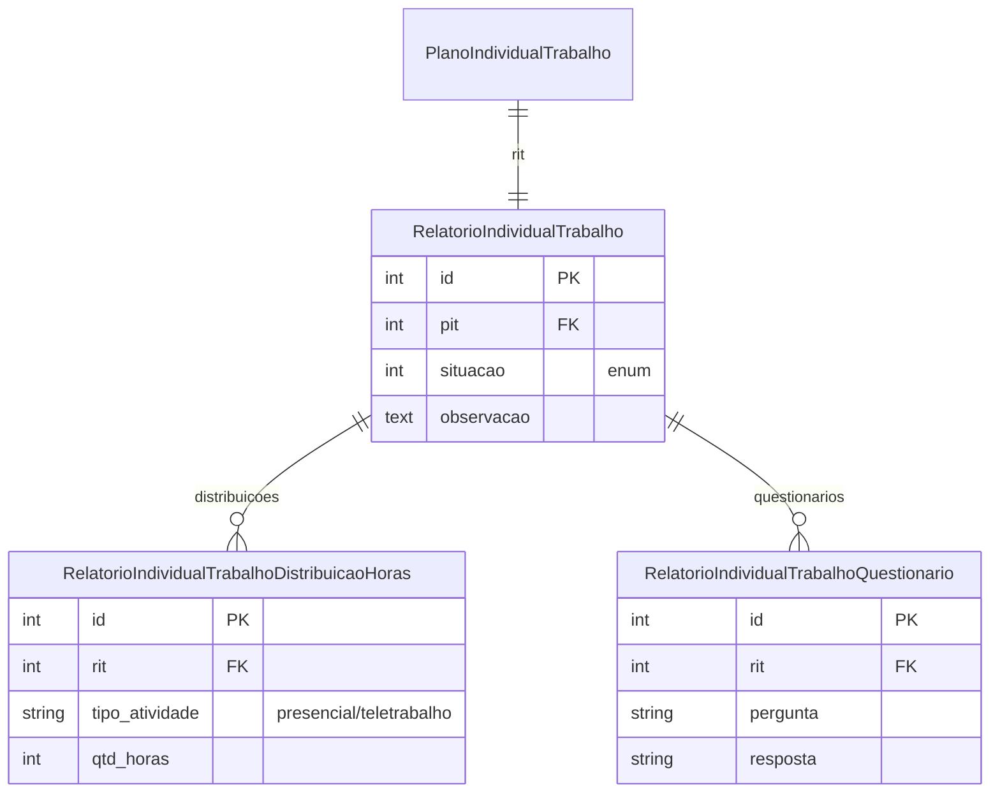

# Modelo de dados — RIT (Relatório Individual de Trabalho)

> ERD das entidades de RIT (models herdam `ModelPlus` de `djtools.db`).
> FKs para entidades de outras áreas aparecem como **externas**.
> Termos: ver [Glossário](../GLOSSARIO.md).

## Entidades

| Entidade | Descrição | Relações-chave |
|---|---|---|
| `RelatorioIndividualTrabalho` | RIT — relatório de execução do PIT | FK `pit` (1:1); 1:N com distribuição de horas e questionário |
| `RelatorioIndividualTrabalhoDistribuicaoHoras` | Rateio da carga horária entre atividades no RIT | FK `rit` |
| `RelatorioIndividualTrabalhoQuestionario` | Respostas a questionário associado ao RIT | FK `rit` |

## Entidades externas referenciadas

| Entidade | Módulo/área de origem |
|---|---|
| `PlanoIndividualTrabalho` | PIT (mesmo módulo) |

---
_Gerado/atualizado via subagent `documentador` em 2026-06-04.
