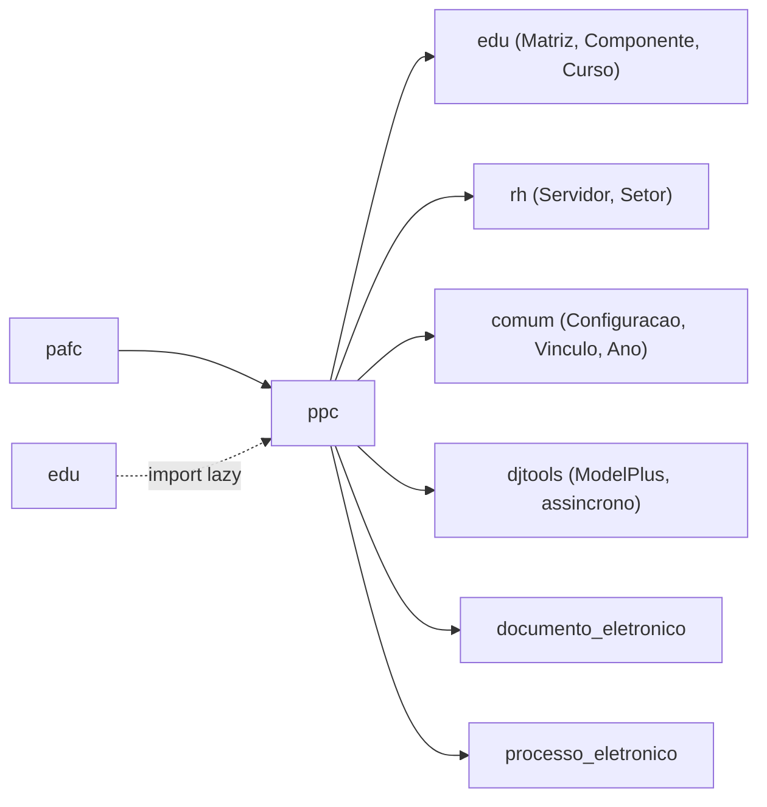

# Fronteiras — Projeto Pedagógico de Curso (PPC)

> Superfície do módulo: o que entra, o que sai e os contratos com o resto do SUAP.
> Complementa o [HLA.md](HLA.md) (§1 contexto, §5 integrações).

## Mapa

## Dependências de entrada (inbound)

Módulos que importam/usam este (de `grep -rl "from ppc" --include=*.py`, excluindo o próprio `ppc` e `migrations/`).

| Módulo consumidor | O que consome | Acoplamento |
|---|---|---|
| `pafc` | `Camara`, `ProReitoria`, `MatrizPPC` (`forms.py`); `DocumentoPPC`, `ProjetoPedagogicoCurso`, `PlanoDisciplina`, `MatrizPPC` (`models.py`); `utils.processar_bibliografia` | Forte — usa models e função utilitária diretamente |
| `edu` | `PlanoDisciplina` e `MatrizPPC` via import lazy (dentro de métodos de `edu/models/cursos.py`) | Fraco — import adiado para evitar ciclo |

## Dependências de saída (outbound)

Confirmado contra `module_dependencies.json` (`ppc`: `comum`, `edu`, `rh`).

| Depende de | O quê | Tipo |
|---|---|---|
| `edu` | Leitura: `Modalidade`, `NaturezaParticipacao`, `Nucleo`, `NivelEnsino`, `EstruturaCurso`, `EixoTecnologico`, `ModalidadePraticaProfissional`, `Convenio`, `AreaConcentracao`, `Turno`, `Componente`, `ComponenteCurricular`, `LogModel`, `CursoCampus`, `Diretoria`, `Matriz`, `MatrizCurso`, etc. | Módulo interno |
| `edu` | Escrita: cria `Matriz`, `Componente`/`ComponenteCurricular`, `MatrizCurso`, `CursoCampus` em `MatrizPPC.gerar_matriz` | Módulo interno (write) |
| `rh` | `Servidor`, `Setor` | Módulo interno |
| `comum` | `Ano`, `Configuracao`, `Vinculo`, `UsuarioGrupo`, `UsuarioGrupoSetor`, `get_sigla_reitoria`; permissões `comum.is_*` | Módulo interno |
| `djtools` | `ModelPlus`/`LogModel`, forms, `transaction`, `assincrono.task`, `utils` (`send_notification`, `retira_acentos`), filtros, `ModelAdminPlus` | Framework SUAP |
| `documento_eletronico` | `DocumentoTexto` (ata, portaria, parecer, deliberação, resolução, despacho) | Integração condicional (`in INSTALLED_APPS`) |
| `processo_eletronico` | `Processo` (convênio) | Integração condicional (`in INSTALLED_APPS`) |
| `ckeditor` | Campos de texto rico nos forms | Biblioteca |

## Contratos publicados

O que outros módulos podem acoplar a este (mude com cuidado):

- **Signals emitidos/ouvidos:** _N/A — o módulo não define nem escuta signals próprios (tramitação é orquestrada por métodos e pelo beat)._
- **Models reusados por outros módulos:** `Camara`, `ProReitoria`, `MatrizPPC`, `DocumentoPPC`, `ProjetoPedagogicoCurso`, `PlanoDisciplina` (consumidos por `pafc`); `PlanoDisciplina` e `MatrizPPC` (consumidos por `edu` via import lazy).
- **Funções / services / templates públicos:** `ppc.utils.processar_bibliografia(projeto, ...)` (reusada por `pafc` e pela task `gerar_bibliografia`).
- **Tasks/agendamento que outros dependem:** task `gerar_bibliografia`/`gerar_minuta_ppc`; job beat `ppc_sincronizar` (avanço de etapas com base em documentos finalizados).
- **Acoplamento por id numérico (sem FK):** `SolicitacaoPPC.id_ata`/`id_portaria`, `DocumentoPPC.id_documento` referenciam `documento_eletronico.DocumentoTexto`; `SolicitacaoPPC.id_processo_convenio` referencia `processo_eletronico.Processo`. ⚠️ REVISAR: contrato implícito — não há FK; perda do documento é tratada como `DOCUMENTO_NAO_EXISTE`.

---
_Gerado/atualizado via subagent `documentador` em 2026-06-04._
