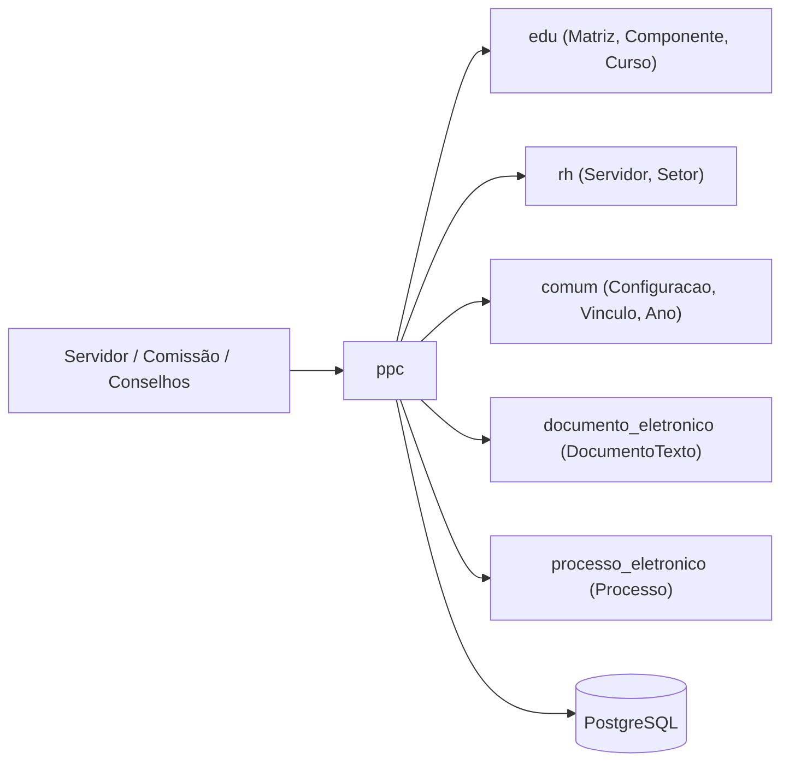
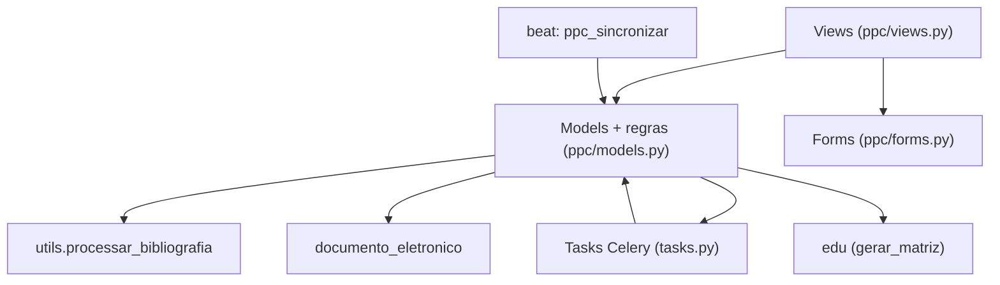
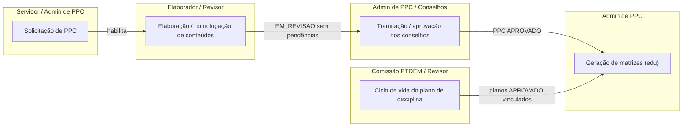

# HLA — Projeto Pedagógico de Curso (PPC)

> High Level Architecture. Complementa o [README.md](README.md). Foco em contexto, blocos, fluxo e riscos. Baseado em arc42 (enxuto) + C4 + Mermaid.

## 1. Contexto e escopo

O `ppc` é usado por servidores, comissões de elaboração e órgãos colegiados para construir
e aprovar Projetos Pedagógicos de Curso. Consome domínio acadêmico de `edu` e pessoas/setores
de `rh`, lê configuração de `comum`, emite documentos no `documento_eletronico` e, ao final,
**escreve** matrizes/componentes/cursos no `edu`.

> Atores definidos em [README.md → Atores e papéis](README.md#atores-e-papéis).

## 2. Estratégia de solução

| Decisão | Escolha | Motivo |
|---|---|---|
| Persistência | `ModelPlus`/`LogModel` em PostgreSQL | Padrão SUAP; `LogModel` provê auditoria |
| Regras de negócio | Fat models (`models.py`) | Transições e validações concentradas nos models; views finas com `@rtr` |
| Workflow | Máquinas de estado por `situacao` (CharField + constantes) | Estados explícitos; transições em métodos `atualizar_situacao`/`pode_*` |
| Processamento assíncrono | Celery via `djtools.assincrono` para minuta e bibliografia | Geração de PDF e agregação de bibliografia são custosas |
| Geração de matriz | Materialização explícita em `edu` (`MatrizPPC.gerar_matriz`) | Separa a fase de planejamento (PPC) da estrutura acadêmica efetiva (`edu`) |
| Documentos oficiais | Integração condicional com `documento_eletronico` | Ata/portaria/pareceres/resoluções controlam o avanço de etapa |

## 3. Blocos de construção (componentes internos)

| Componente | Responsabilidade |
|---|---|
| Views/Forms | Entrypoints das rotas `/ppc/`; orquestram chamadas aos métodos dos models |
| Models (fat) | Entidades, validações de CH, três máquinas de estado e a geração da matriz |
| `utils` | Consolidação da bibliografia a partir dos planos de disciplina |
| Tasks/Beat | Minuta e bibliografia assíncronas; sincronização diária de situações |

Modelo de dados (ERD): ver [modelo-de-dados/](modelo-de-dados/).

## 4. Fluxos principais

Cada fluxo feliz importante tem um arquivo em `docs/fluxos/`. Os mais centrais primeiro.

| Fluxo | Ator | Gatilho | Doc |
|---|---|---|---|
| Solicitação de PPC até início do PPC | Servidor / Admin de PPC | POST `/ppc/solicitacaoppc/<pk>/enviar/` | [fluxos/solicitacao-ppc.md](fluxos/solicitacao-ppc.md) |
| Tramitação e aprovação do PPC nos conselhos | Admin de PPC / Conselhos | POST `/ppc/projetopedagogicocurso/<pk>/emitir_documento/...` | [fluxos/tramitacao-aprovacao-ppc.md](fluxos/tramitacao-aprovacao-ppc.md) |
| Elaboração e homologação de conteúdos | Elaborador / Revisor | POST `/ppc/conteudoppc/<pk>/alterar_situacao/...` | [fluxos/elaboracao-conteudos-ppc.md](fluxos/elaboracao-conteudos-ppc.md) |
| Geração de matrizes no `edu` | Admin de PPC | POST `/ppc/projetopedagogicocurso/<pk>/gerar_matriz/` | [fluxos/geracao-matriz.md](fluxos/geracao-matriz.md) |
| Ciclo de vida do plano de disciplina | Comissão PTDEM / Revisor | POST `/ppc/planodisciplina/<pk>/aprovar/` | [fluxos/plano-disciplina.md](fluxos/plano-disciplina.md) |

### Mapa de fluxos (raias por ator)

Visão integrada: como os fluxos se **encadeiam** (quem dispara/precede quem). Raias
(`subgraph`) = ator principal; nós = fluxos; setas = dependência (derivada dos campos
`Depende de`/`Habilita` de cada fluxo). O ciclo do plano de disciplina é independente e
converge na geração de matriz, junto com a aprovação nos conselhos.

## 5. Integrações

| Integração | Direção | Como | Onde |
|---|---|---|---|
| `edu` | out (read) | Modelos de domínio acadêmico (Modalidade, Núcleo, NivelEnsino, EstruturaCurso, etc.) | imports em `models.py` |
| `edu` | out (write) | Cria `Matriz`, `Componente`/`ComponenteCurricular`, `MatrizCurso`, `CursoCampus` | `MatrizPPC.gerar_matriz` |
| `rh` | out (read) | `Servidor`, `Setor` em FKs/M2M | `models.py` |
| `comum` | out (read) | `Ano`, `Vinculo`, `Configuracao`, grupos | `models.py`, `views.py` |
| `documento_eletronico` | in/out | `DocumentoTexto` por id; situação do documento move a etapa | `SolicitacaoPPC`/`DocumentoPPC.atualizar_situacao` (condicional) |
| `processo_eletronico` | out | `Processo` (convênio) por id | `SolicitacaoPPC.get_processo_convenio` (condicional) |
| `pafc` | in | Importa `Camara`, `ProReitoria`, `MatrizPPC`, `DocumentoPPC`, `ProjetoPedagogicoCurso`, `PlanoDisciplina` e `utils.processar_bibliografia` | `pafc/models.py`, `pafc/forms.py` |

Mapa completo de fronteira (dependências inbound/outbound + contratos): ver [FRONTEIRA.md](FRONTEIRA.md).

## 6. Conceitos transversais

- **Transações:** `@transaction.atomic` em transições e replicações críticas (`gerar_matriz`, `ativar`, `replicar`, `atualizar_situacao`, `adicionar_elaborador`).
- **Locks / concorrência:** sem lock distribuído explícito; idempotência das transições garantida por verificação de estado (`pode_*`/`is_matriz_gerada`) e pelo beat que só reprocessa pendências.
- **Storage:** `FileFieldPlus` (arquivo da diretriz); PDFs gerados via `@rtr('*.html')`/tasks (arquivo temporário).
- **Permissões:** grupos em `permissions.yaml` + permissões de model (`ppc.*`) + papéis relacionais (comissões/elaboradores/revisores via FK/M2M).
- **Auditoria:** todos os models herdam `LogModel`; movimentações explícitas em `MovimentacaoPPC`, `MovimentacaoSolicitacaoPPC`, `MovimentacaoPlanoDisciplina` e `HistoricoElaboradorPPC`.

## 7. Riscos e débito técnico

- **Acoplamento por id numérico** (sem FK) com `documento_eletronico`/`processo_eletronico` (`id_ata`, `id_portaria`, `id_documento`, `id_processo_convenio`) — quebra silenciosa se o documento sumir (tratado como `DOCUMENTO_NAO_EXISTE`).
- **Tramitação de conselhos altamente ramificada** (`DocumentoPPC.atualizar_situacao`): muitos ramos por decisão; vários `# TODO: notificar` indicam notificações pendentes.
- **`models.py` monolítico (≈282 KB, 41 models)** dificulta navegação e manutenção.
- **Ausência de testes automatizados** no app (`ppc/tests/` não encontrado). ⚠️ REVISAR.
- > ⚠️ REVISAR: a aba "Solicitar adequação de PPC" está desabilitada em código (`admin.py`) "até validação do fluxo pela proen" — o fluxo de adequação pode estar incompleto.

## 8. Glossário

Linguagem ubíqua, siglas e mapa entidade↔negócio: ver [GLOSSARIO.md](GLOSSARIO.md).

---
_Gerado/atualizado via subagent `documentador` em 2026-06-04._
