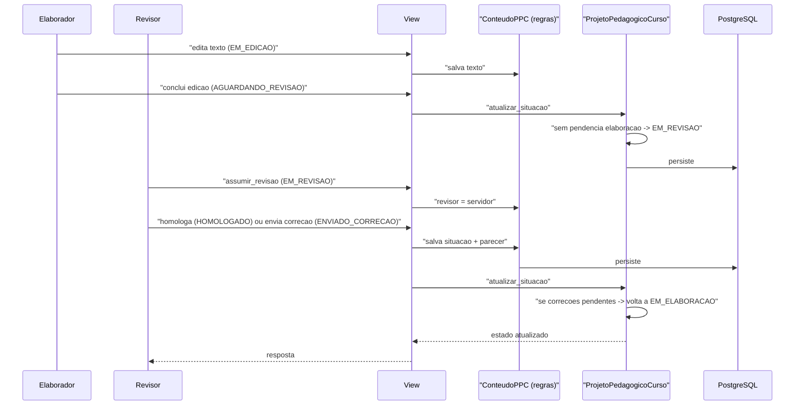

# Fluxo: Elaboração e homologação de conteúdos do PPC

> Como a comissão preenche os conteúdos do PPC e os revisores os homologam.

- **Ator(es):** Elaborador (edição), Revisor (homologação) — ver [README → Atores e papéis](../README.md#atores-e-papéis)
- **Gatilho:** POST `/ppc/conteudoppc/<pk>/alterar_situacao/<situacao>/`, `assumir_revisao`, `retomar_edicao`
- **Pré-condições:** PPC em `EM_ELABORACAO` (edição) ou `EM_REVISAO` (homologação); conteúdo `editavel`
- **Pós-condições:** Conteúdos homologados; PPC transita `EM_ELABORACAO ↔ EM_REVISAO` quando não há pendências
- **Depende de:** [Solicitação de PPC até o início do PPC](solicitacao-ppc.md) (PPC precisa existir em `INICIADO`/`EM_ELABORACAO`, com `ConteudoPPC` e elaboradores criados pelo `iniciar_ppc()`)
- **Habilita:** [Tramitação e aprovação do PPC nos conselhos](tramitacao-aprovacao-ppc.md) (`pode_informar_reitoria` exige PPC em `EM_REVISAO` sem pendências)
- **Entrada no código:** `views.alterar_situacao_conteudoppc`/`assumir_revisao`/`retomar_edicao`; regras em `ConteudoPPC` e `ProjetoPedagogicoCurso.atualizar_situacao` (`models.py`)

## Sequência

## Observações

- Estados do conteúdo: `EM_EDICAO → AGUARDANDO_REVISAO → EM_REVISAO → (HOMOLOGADO | ENVIADO_CORRECAO)`.
- O PPC alterna entre `EM_ELABORACAO` e `EM_REVISAO` automaticamente em `ProjetoPedagogicoCurso.atualizar_situacao`, conforme `possui_pendencia_elaboracao()`/`possui_pendencia_revisao()`. Ao entrar em revisão, processa a bibliografia (`processar_bibliografia`) e arrasta as situações de matriz/prática.
- Conteúdos não editáveis nascem `HOMOLOGADO`; tornar um conteúdo editável/não editável propaga para os `ConteudoPPC` dos PPCs em andamento (`Conteudo.tornar_editavel`/`tornar_nao_editavel`/`atualizar_texto`).
- Permissões: edição exige `ElaboradorPPC.PERMISSAO_EDICAO` (ou admin de PPC); revisão exige `RevisorPPC` do PPC.

---
_Gerado/atualizado via subagent `documentador` em 2026-06-04._
