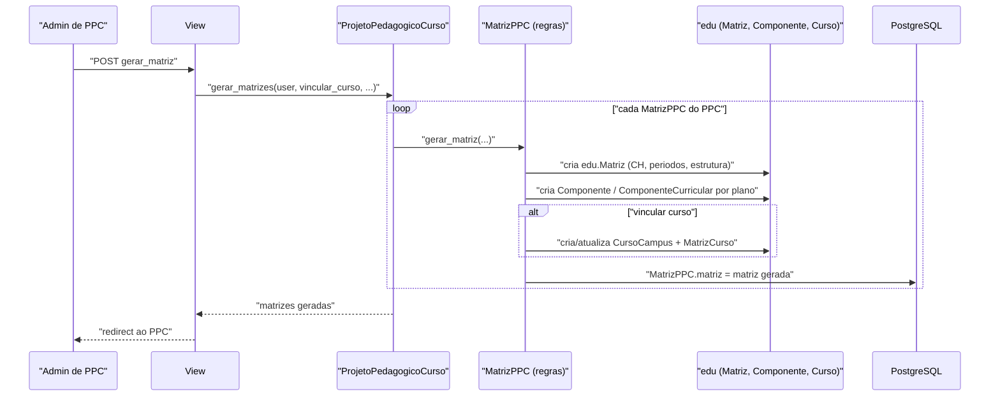

# Fluxo: Geração de matrizes no módulo edu

> Como um PPC aprovado é materializado em matriz curricular, componentes e (opcionalmente) cursos no `edu`.

- **Ator(es):** Administrador de PPC — ver [README → Atores e papéis](../README.md#atores-e-papéis)
- **Gatilho:** POST `/ppc/projetopedagogicocurso/<pk>/gerar_matriz/`
- **Pré-condições:** PPC em `APROVADO`; matrizes do PPC homologadas com planos de disciplina vinculados
- **Pós-condições:** `edu.Matriz` criada e ligada à `MatrizPPC`; componentes/curriculares gerados; PPC pode ser finalizado (`FINALIZADO`, `vigente=True`)
- **Depende de:** [Tramitação e aprovação do PPC nos conselhos](tramitacao-aprovacao-ppc.md) (PPC precisa estar `APROVADO`) e [Ciclo de vida do plano de disciplina](plano-disciplina.md) (cada `PlanoDisciplina` vinculado à matriz precisa estar `APROVADO` para a `MatrizPPC` ser aprovável)
- **Habilita:** _nenhum_
- **Entrada no código:** `views.gerar_matriz_projetopedagogicocurso`; regras em `ProjetoPedagogicoCurso.gerar_matrizes` → `MatrizPPC.gerar_matriz` (`models.py`)

## Sequência

## Observações

- `MatrizPPC.gerar_matriz` só cria a matriz se ainda não foi gerada (`is_matriz_gerada()`) — **idempotente** quanto à `edu.Matriz`.
- A `edu.Matriz` herda dados do PPC e da diretriz: CH por tipo de componente, períodos, estrutura, nível, natureza, exigência de TCC/estágio/extensão e certificação parcial.
- Geração de **curso** (`gerar_cursos_matrizppc`/`vincular_cursos_matrizppc`) é separada e condicionada por `Configuracao` (`permite_gerar_curso_matriz`, `permite_gerar_curso_sem_pafc`).
- Esta é a **principal escrita do `ppc` no `edu`** — ver [FRONTEIRA.md](../FRONTEIRA.md).
- > ⚠️ REVISAR: o detalhe da geração de pré/co-requisitos e da CH de extensão por componente não foi totalmente diagramado (lógica extensa em `gerar_matriz`).

---
_Gerado/atualizado via subagent `documentador` em 2026-06-04._
