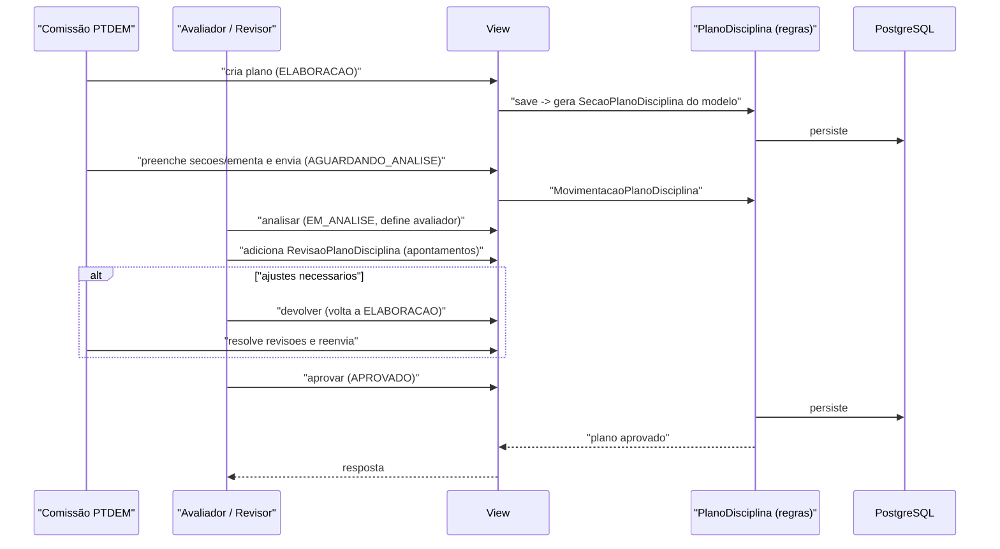

# Fluxo: Ciclo de vida do plano de disciplina

> Como uma comissão elabora um plano de disciplina e ele é revisado e aprovado.

- **Ator(es):** Comissão PTDEM (elaboração), Revisor/Avaliador de plano (análise) — ver [README → Atores e papéis](../README.md#atores-e-papéis)
- **Gatilho:** Cadastro no admin e POST `/ppc/planodisciplina/<pk>/enviar/` → `analisar/` → `aprovar/`
- **Pré-condições:** Existe `ModeloPlanoDisciplina` ativo para o nível de ensino; servidor pertence a uma `ComissaoPTDEM`
- **Pós-condições:** Plano em `APROVADO` (ou `REJEITADO`); disponível para vínculo às matrizes de PPC
- **Depende de:** _nenhum_ (ciclo independente; só requer `ModeloPlanoDisciplina` ativo e `ComissaoPTDEM`)
- **Habilita:** [Geração de matrizes no módulo edu](geracao-matriz.md) (planos `APROVADO` vinculados via `PlanoDisciplinaPPC` são pré-requisito para a `MatrizPPC` ser aprovável)
- **Entrada no código:** `views.planodisciplina` e transições `enviar/analisar/aprovar/desaprovar/devolver/reprovar_planodisciplina`; regras em `PlanoDisciplina` (`models.py`)

## Sequência

## Observações

- Estados: `ELABORACAO → AGUARDANDO_ANALISE → EM_ANALISE → (APROVADO | REJEITADO)`; `devolver` retorna à elaboração.
- Ao salvar um plano novo, o `save()` instancia automaticamente as `SecaoPlanoDisciplina` a partir do `ModeloSecaoPlanoDisciplina` do modelo ativo do nível de ensino.
- Revisões (`RevisaoPlanoDisciplina`) e comentários (`ComentarioRevisaoPlanoDisciplina`) registram o diálogo entre avaliador e comissão; só podem ser marcadas como resolvidas conforme a fase do plano.
- Versão EAD: `criar_versao_ead_planodisciplina` quando o modelo `permite_secoes_ead`/`permite_versao_ead_plano_aprovado`.
- O avaliador/revisor é definido via `PlanoDisciplina.avaliador` e o cadastro global `RevisorPlanoDisciplina`; o setor padrão vem de `Configuracao('ppc','setor_revisao_plano_disciplina')`.

---
_Gerado/atualizado via subagent `documentador` em 2026-06-04._
