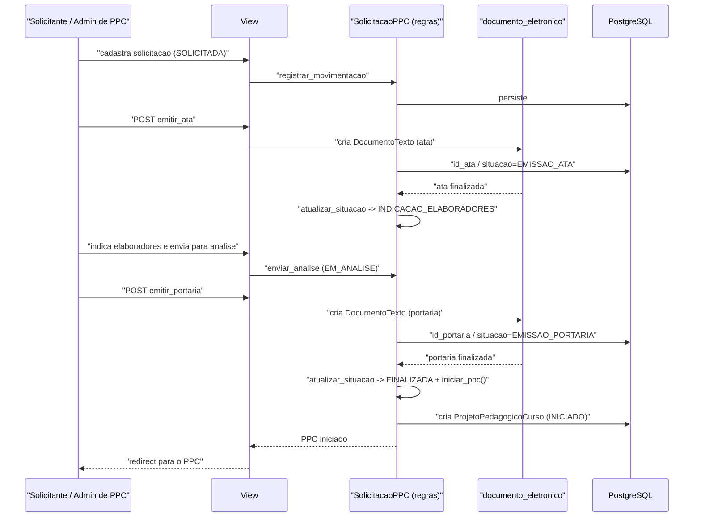

# Fluxo: Solicitação de PPC até o início do PPC

> Como um pedido de criação de PPC tramita da solicitação até a geração do PPC em elaboração.

- **Ator(es):** Servidor solicitante, Colegiado, Administrador de PPC — ver [README → Atores e papéis](../README.md#atores-e-papéis)
- **Gatilho:** Cadastro da solicitação no admin e POST `/ppc/solicitacaoppc/<pk>/enviar/`
- **Pré-condições:** Existe diretriz/modelo de PPC ativo para o tipo de oferta e modalidade pretendidos
- **Pós-condições:** Portaria de elaboração finalizada → PPC criado (`ProjetoPedagogicoCurso` em `INICIADO`) e comissão de elaboração constituída
- **Depende de:** _nenhum_
- **Habilita:** [Elaboração e homologação de conteúdos do PPC](elaboracao-conteudos-ppc.md) (o `iniciar_ppc()` materializa o `ProjetoPedagogicoCurso`, os `ConteudoPPC`, a `MatrizPPC` e os elaboradores)
- **Entrada no código:** `views.solicitacaoppc` e transições `views.enviar_solicitacaoppc`/`emitir_ata_solicitacaoppc`/`emitir_portaria_solicitacaoppc`; regras em `SolicitacaoPPC` (`models.py`)

## Sequência

## Observações

- A máquina de estado é `SOLICITADA → EMISSAO_ATA → INDICACAO_ELABORADORES → EM_ANALISE → EMISSAO_PORTARIA → FINALIZADA` (com ramos `REJEITADA` e `SUSPENSA`).
- O avanço de etapa depende do **documento eletrônico estar finalizado**: `SolicitacaoPPC.atualizar_situacao` reage à finalização da ata e da portaria (também acionado pelo beat `ppc_sincronizar`).
- `pode_iniciar_ppc()` + `iniciar_ppc()` materializam o `ProjetoPedagogicoCurso` e notificam solicitante/elaboradores.
- Há dois tipos: `TIPO_CRIACAO` e `TIPO_ADEQUACAO`. > ⚠️ REVISAR: a entrada de "Solicitar adequação" está desabilitada no admin "até validação do fluxo pela proen".
- Integração com `documento_eletronico` é **condicional** (`'documento_eletronico' in settings.INSTALLED_APPS`); ausência do documento é tratada como `DOCUMENTO_NAO_EXISTE`.

---
_Gerado/atualizado via subagent `documentador` em 2026-06-04._
