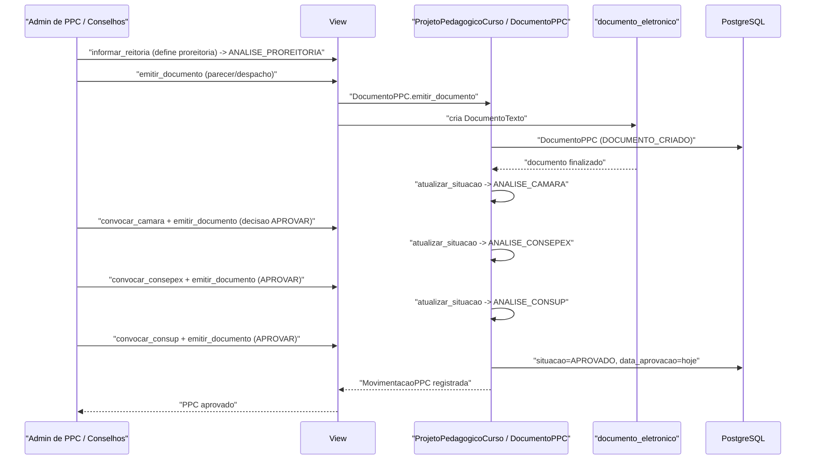

# Fluxo: Tramitação e aprovação do PPC nos conselhos

> Como um PPC revisado avança pelos órgãos colegiados até ser aprovado.

- **Ator(es):** Administrador de PPC, Pró-Reitoria, Câmara, CONSEPEX, CONSUP — ver [README → Atores e papéis](../README.md#atores-e-papéis)
- **Gatilho:** POST `/ppc/projetopedagogicocurso/<pk>/informar_reitoria/`, `convocar_*` e `emitir_documento/<documento>/`
- **Pré-condições:** PPC em `EM_REVISAO` sem pendências; Pró-Reitoria/Câmara associadas
- **Pós-condições:** PPC em `APROVADO` (ou `REJEITADO`); `data_aprovacao` definida
- **Depende de:** [Elaboração e homologação de conteúdos do PPC](elaboracao-conteudos-ppc.md) (entra a partir de `EM_REVISAO`, alcançado quando elaboração/revisão estão sem pendências)
- **Habilita:** [Geração de matrizes no módulo edu](geracao-matriz.md) (`pode_gerar_matrizes` exige `situacao == APROVADO`)
- **Entrada no código:** `views.emitir_documento_projetopedagogicocurso`; regras em `DocumentoPPC.emitir_documento`/`atualizar_situacao` (`models.py`)

## Sequência (caminho feliz — aprovação)

## Observações

- Estados: `EM_REVISAO → ANALISE_PROREITORIA → ANALISE_CAMARA → ANALISE_CONSEPEX → ANALISE_CONSUP → APROVADO` (depois `FINALIZADO` na geração de matriz, ou `REJEITADO`).
- O avanço sempre depende da **finalização do `DocumentoPPC`** da etapa (acionado também pelo beat `ppc_sincronizar`), em `DocumentoPPC.atualizar_situacao`.
- Cada etapa tem ramos por `decisao`: `DECISAO_APROVAR` (avança), `DECISAO_APROVAR_RESSALVA`/`DECISAO_SOLICITAR_CORRECAO` (volta para `EM_REVISAO`), `DECISAO_REJEITAR` (vai para `REJEITADO`). Flags `ad_referendum`, `pular_camara`, `camara_inexistente`, `consepex_inexistente` desviam o caminho — detalhes não diagramados aqui (ramos em `models.py`).
- `rejeitado_proreitoria` na etapa da Pró-Reitoria reprova o PPC.
- > ⚠️ REVISAR: vários `# TODO: notificar` indicam que as notificações de mudança de etapa não estão implementadas.

---
_Gerado/atualizado via subagent `documentador` em 2026-06-04._
