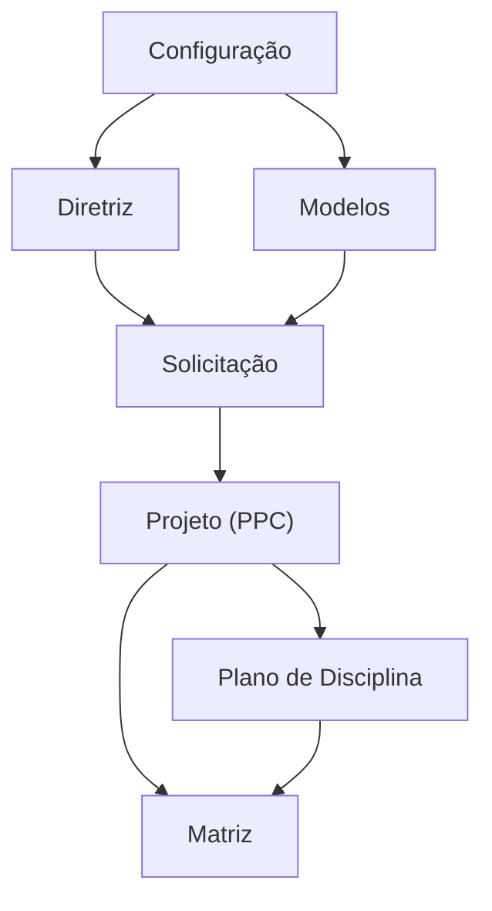

# Modelo de dados — Projeto Pedagógico de Curso (PPC)

> Módulo grande (41 models em um único `models.py`): o modelo está particionado por
> **subdomínio**. Como o app **não** usa pacote `models/`, o agrupamento foi inferido por
> clusters de nome/relação + agrupamento do `admin.py`. ⚠️ REVISAR: as fronteiras entre
> subdomínios são inferidas, não declaradas no código.
>
> Cada sub-área tem seu próprio ERD; este índice dá a visão macro e como as áreas se
> conectam. FKs entre subdomínios aparecem como "entidades externas" em cada ERD.

## Subdomínios

| Subdomínio | Entidades principais | ERD |
|---|---|---|
| Configuração | `ComissaoPTDEM`, `AdministradorTipoOferta`, `Camara`, `ProReitoria` | [configuracao.md](configuracao.md) |
| Diretriz | `Diretriz`, `NucleoDiretriz`, `EixoTecnologicoDiretriz`, `ModalidadePraticaProfissionalDiretriz`, `PeriodoDiretriz`, `ComponenteExigidoDiretriz` | [diretriz.md](diretriz.md) |
| Modelos (templates) | `ModeloPPC`, `Secao`, `Conteudo`, `ModeloPlanoDisciplina`, `ModeloSecaoPlanoDisciplina` | [modelos.md](modelos.md) |
| Solicitação | `SolicitacaoPPC`, `MembroColegiado`, `IndicacaoElaboradorPPC`, `MovimentacaoSolicitacaoPPC` | [solicitacao.md](solicitacao.md) |
| Projeto (PPC) | `ProjetoPedagogicoCurso`, `ConteudoPPC`, `ComentarioConteudoPPC`, `DocumentoPPC`, `ElaboradorPPC`, `ColaboradorPPC`, `AtualizacaoComissaoElaboracao`, `HistoricoElaboradorPPC`, `RevisorPPC`, `MovimentacaoPPC`, `CertificacaoParcial`, `PlanoDisciplinaCertificacaoParcial` | [projeto.md](projeto.md) |
| Matriz | `MatrizPPC`, `ConfiguracaoOptativasMatrizPPC`, `PlanoDisciplinaPPC`, `ModalidadePraticaProfissionalPPC` | [matriz.md](matriz.md) |
| Plano de Disciplina | `PlanoDisciplina`, `RevisaoPlanoDisciplina`, `ComentarioRevisaoPlanoDisciplina`, `SecaoPlanoDisciplina`, `MovimentacaoPlanoDisciplina`, `RevisorPlanoDisciplina` | [plano-disciplina.md](plano-disciplina.md) |

**Cobertura:** 6 + 5 + 4 + 12 + 4 + 6 + 4 = **41 models** (todos os do módulo, cada um em exatamente um ERD).

---
_Gerado/atualizado via subagent `documentador` em 2026-06-04._
