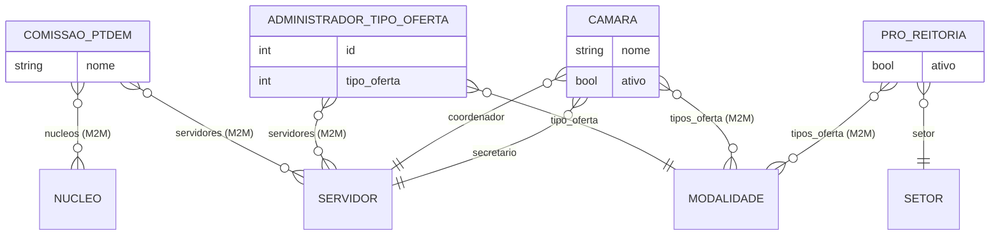

# Modelo de dados — Configuração (PPC)

> ERD das entidades de configuração transversal do módulo `ppc` (models herdam
> `ModelPlus`/`LogModel` de `djtools.db`/`edu`). FKs para outras áreas aparecem como
> **externas**. Termos: ver [../GLOSSARIO.md](../GLOSSARIO.md).

## Entidades

| Entidade | Descrição | Relações-chave |
|---|---|---|
| `ComissaoPTDEM` | Comissão que elabora planos de disciplina | M2M `rh.Servidor`, M2M `edu.Nucleo` |
| `AdministradorTipoOferta` | Servidores que administram diretrizes/modelos de um tipo de oferta | FK `edu.Modalidade`; M2M `rh.Servidor` |
| `Camara` | Câmara de análise do PPC, por tipos de oferta | FK `rh.Servidor` (coordenador/secretário); M2M `edu.Modalidade` |
| `ProReitoria` | Pró-Reitoria que analisa o PPC | FK `rh.Setor`; M2M `edu.Modalidade` |

## Entidades externas referenciadas

| Entidade | Módulo/área de origem |
|---|---|
| `Servidor` | `rh` |
| `Setor` | `rh` |
| `Modalidade` (tipo de oferta) | `edu` |
| `Nucleo` | `edu` |

---
_Gerado/atualizado via subagent `documentador` em 2026-06-04._
