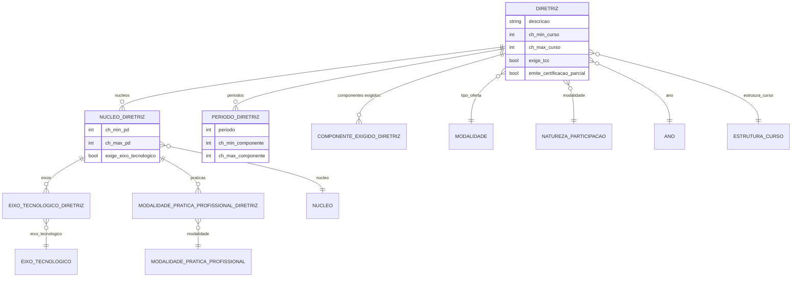

# Modelo de dados — Diretriz (PPC)

> ERD das entidades que definem as regras curriculares por ano/tipo de oferta/modalidade.
> Models herdam `LogModel`. FKs externas marcadas como tal. Termos: ver
> [../GLOSSARIO.md](../GLOSSARIO.md).

## Entidades

| Entidade | Descrição | Relações-chave |
|---|---|---|
| `Diretriz` | Regras de CH, períodos e estrutura por ano/tipo de oferta/modalidade | FK `comum.Ano`, `edu.EstruturaCurso`, `edu.Modalidade`, `edu.NaturezaParticipacao` |
| `NucleoDiretriz` | Configuração de um núcleo dentro da diretriz (CH de planos, prática, eixos) | FK `Diretriz`, `edu.Nucleo` |
| `EixoTecnologicoDiretriz` | CH por eixo tecnológico de um núcleo que exige eixo | FK `NucleoDiretriz`, `edu.EixoTecnologico` |
| `ModalidadePraticaProfissionalDiretriz` | Prática profissional exigida/optativa por núcleo | FK `NucleoDiretriz`, `edu.ModalidadePraticaProfissional` |
| `PeriodoDiretriz` | Limites de CH de componentes por período da diretriz | FK `Diretriz` |
| `ComponenteExigidoDiretriz` | Componente obrigatório (por nome) com CH mínima | FK `Diretriz` |

## Entidades externas referenciadas

| Entidade | Módulo/área de origem |
|---|---|
| `Ano` | `comum` |
| `Modalidade`, `NaturezaParticipacao`, `EstruturaCurso`, `Nucleo`, `EixoTecnologico`, `ModalidadePraticaProfissional` | `edu` |

---
_Gerado/atualizado via subagent `documentador` em 2026-06-04._
