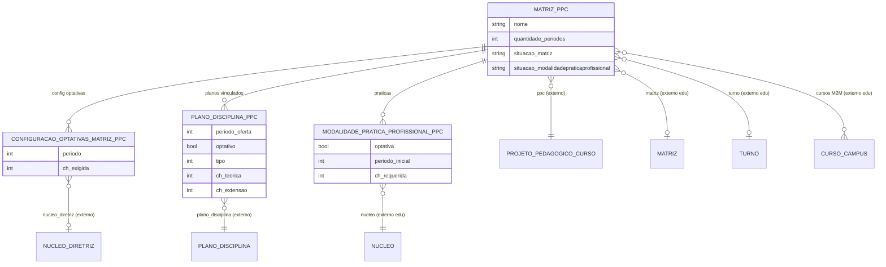

# Modelo de dados — Matriz (PPC)

> ERD do subdomínio de matriz curricular do PPC: o planejamento da matriz, a configuração
> de optativas, o vínculo dos planos e as modalidades de prática profissional. A geração
> efetiva escreve em `edu.Matriz` (entidade externa). Models herdam `LogModel`. Termos:
> ver [../GLOSSARIO.md](../GLOSSARIO.md).

## Entidades

| Entidade | Descrição | Relações-chave |
|---|---|---|
| `MatrizPPC` | Planejamento da matriz curricular do PPC; gera a `edu.Matriz`; máquinas de estado de matriz e de prática | FK `ProjetoPedagogicoCurso`, `edu.Matriz`, `edu.Turno`; M2M `edu.CursoCampus` |
| `ConfiguracaoOptativasMatrizPPC` | CH exigida de optativas por período da matriz | FK `MatrizPPC`, `NucleoDiretriz` |
| `PlanoDisciplinaPPC` | Vínculo de um plano de disciplina à matriz (período, tipo, CH teórica/extensão/EAD) | FK `PlanoDisciplina`, `MatrizPPC` |
| `ModalidadePraticaProfissionalPPC` | Prática profissional definida na matriz do PPC, por núcleo | FK `MatrizPPC`, `edu.ModalidadePraticaProfissional`, `edu.Nucleo` |

## Entidades externas referenciadas

| Entidade | Módulo/área de origem |
|---|---|
| `ProjetoPedagogicoCurso` | `ppc` (subdomínio Projeto) |
| `PlanoDisciplina` | `ppc` (subdomínio Plano de Disciplina) |
| `NucleoDiretriz` | `ppc` (subdomínio Diretriz) |
| `Matriz`, `Turno`, `CursoCampus`, `Nucleo`, `ModalidadePraticaProfissional` | `edu` |

---
_Gerado/atualizado via subagent `documentador` em 2026-06-04._
