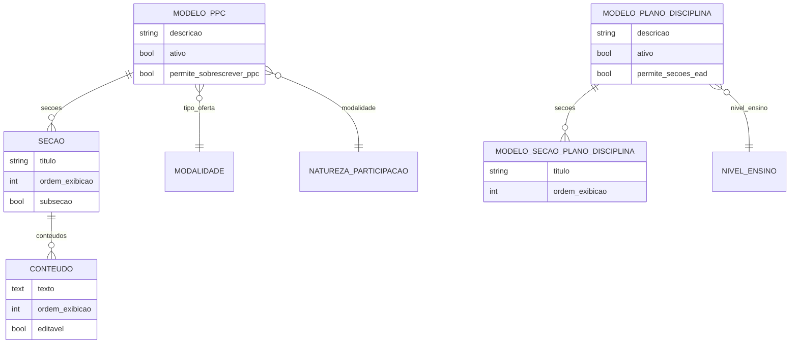

# Modelo de dados — Modelos / Templates (PPC)

> ERD dos templates reutilizáveis: modelos de PPC (seções/conteúdos) e modelos de plano
> de disciplina. Models herdam `LogModel`. Termos: ver [../GLOSSARIO.md](../GLOSSARIO.md).

## Entidades

| Entidade | Descrição | Relações-chave |
|---|---|---|
| `ModeloPPC` | Template de PPC ativo por tipo de oferta + modalidade | FK `edu.Modalidade`, `edu.NaturezaParticipacao` |
| `Secao` | Seção (ou subseção) ordenável de um modelo de PPC | FK `ModeloPPC` |
| `Conteudo` | Conteúdo de uma seção (texto + orientação); editável ou fixo | FK `Secao` |
| `ModeloPlanoDisciplina` | Template de plano de disciplina ativo por nível de ensino | FK `edu.NivelEnsino` |
| `ModeloSecaoPlanoDisciplina` | Seção ordenável do modelo de plano de disciplina | FK `ModeloPlanoDisciplina` |

## Entidades externas referenciadas

| Entidade | Módulo/área de origem |
|---|---|
| `Modalidade` (tipo de oferta), `NaturezaParticipacao`, `NivelEnsino` | `edu` |

---
_Gerado/atualizado via subagent `documentador` em 2026-06-04._
