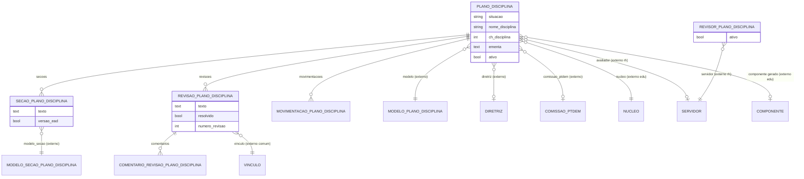

# Modelo de dados — Plano de Disciplina (PPC)

> ERD do subdomínio de planos de disciplina: o plano, suas seções, revisões/comentários,
> movimentações e revisores. Models herdam `LogModel`. Termos: ver
> [../GLOSSARIO.md](../GLOSSARIO.md).

## Entidades

| Entidade | Descrição | Relações-chave |
|---|---|---|
| `PlanoDisciplina` | Plano de disciplina (ementa/programa); ciclo elaboração→análise→aprovado | FK `ModeloPlanoDisciplina`, `Diretriz`, `ComissaoPTDEM`, `edu.Modalidade`, `edu.Nucleo`, `rh.Servidor` (avaliador), `edu.Componente` |
| `SecaoPlanoDisciplina` | Seção preenchida do plano (texto; versão EAD opcional) | FK `PlanoDisciplina`, `ModeloSecaoPlanoDisciplina` |
| `RevisaoPlanoDisciplina` | Apontamento de revisão sobre o plano | FK `PlanoDisciplina`, `comum.Vinculo` |
| `ComentarioRevisaoPlanoDisciplina` | Comentário (manual/automático) em uma revisão | FK `RevisaoPlanoDisciplina`, `comum.Vinculo` |
| `MovimentacaoPlanoDisciplina` | Registro de cada transição de situação do plano | FK `PlanoDisciplina`, `comum.Vinculo` |
| `RevisorPlanoDisciplina` | Servidor habilitado a revisar planos de disciplina (cadastro global) | FK `rh.Servidor` |

## Entidades externas referenciadas

| Entidade | Módulo/área de origem |
|---|---|
| `ModeloPlanoDisciplina`, `ModeloSecaoPlanoDisciplina` | `ppc` (subdomínio Modelos) |
| `Diretriz` | `ppc` (subdomínio Diretriz) |
| `ComissaoPTDEM` | `ppc` (subdomínio Configuração) |
| `Servidor` | `rh` |
| `Vinculo` | `comum` |
| `Modalidade`, `Nucleo`, `Componente` | `edu` |

---
_Gerado/atualizado via subagent `documentador` em 2026-06-04._
