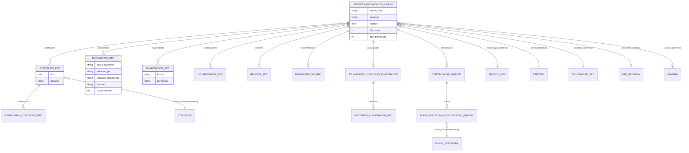

# Modelo de dados — Projeto (PPC)

> ERD do subdomínio central: o PPC, seus conteúdos, comissão (elaboradores/colaboradores/
> revisores), documentos da tramitação, movimentações e certificação intermediária.
> Models herdam `LogModel`. Termos: ver [../GLOSSARIO.md](../GLOSSARIO.md).

## Entidades

| Entidade | Descrição | Relações-chave |
|---|---|---|
| `ProjetoPedagogicoCurso` | O PPC; máquina de estado central (elaboração→revisão→tramitação→aprovado/finalizado) | FK `ModeloPPC`, `Diretriz`, `SolicitacaoPPC`, `ProReitoria`, `Camara` |
| `ConteudoPPC` | Instância editável de um `Conteudo` do modelo, dentro do PPC | FK `ProjetoPedagogicoCurso`, `Conteudo`, `rh.Servidor` (revisor) |
| `ComentarioConteudoPPC` | Comentário de revisão sobre um conteúdo do PPC | FK `ConteudoPPC`, `rh.Servidor` |
| `DocumentoPPC` | Documento eletrônico emitido em cada etapa da tramitação (parecer/deliberação/resolução/despacho) | FK `ProjetoPedagogicoCurso`, `rh.Servidor` |
| `ElaboradorPPC` | Membro da comissão de elaboração (coordenador/membro; leitura/edição) | FK `ProjetoPedagogicoCurso`, `rh.Servidor` |
| `ColaboradorPPC` | Colaborador (acesso) do PPC | FK `ProjetoPedagogicoCurso`, `rh.Servidor` |
| `RevisorPPC` | Servidor revisor do PPC | FK `ProjetoPedagogicoCurso`, `rh.Servidor` |
| `AtualizacaoComissaoElaboracao` | Registro de atualização da comissão (vinculada a portaria) | FK `ProjetoPedagogicoCurso` |
| `HistoricoElaboradorPPC` | Histórico (cadastro/edição/exclusão) de elaboradores por atualização | FK `AtualizacaoComissaoElaboracao`, `rh.Servidor` |
| `MovimentacaoPPC` | Registro de cada transição de situação do PPC | FK `ProjetoPedagogicoCurso`, `comum.Vinculo` |
| `CertificacaoParcial` | Certificação intermediária do PPC (titulação, CH) | FK `ProjetoPedagogicoCurso`, `edu.Modalidade` |
| `PlanoDisciplinaCertificacaoParcial` | Vínculo de planos de disciplina à certificação intermediária | FK `CertificacaoParcial`, `PlanoDisciplina` |

## Entidades externas referenciadas

| Entidade | Módulo/área de origem |
|---|---|
| `ModeloPPC`, `Conteudo` | `ppc` (subdomínio Modelos) |
| `Diretriz` | `ppc` (subdomínio Diretriz) |
| `SolicitacaoPPC` | `ppc` (subdomínio Solicitação) |
| `ProReitoria`, `Camara` | `ppc` (subdomínio Configuração) |
| `PlanoDisciplina` | `ppc` (subdomínio Plano de Disciplina) |
| `Servidor` | `rh` |
| `Vinculo` | `comum` |
| `Modalidade` | `edu` |

---
_Gerado/atualizado via subagent `documentador` em 2026-06-04._
