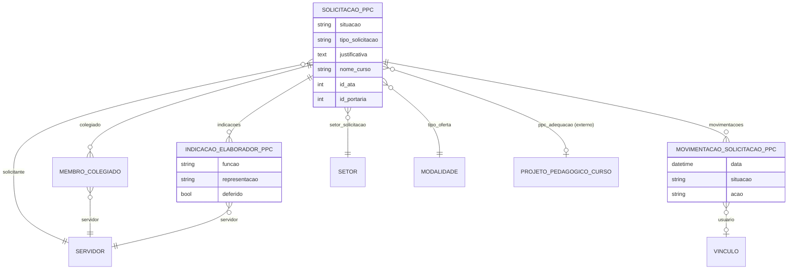

# Modelo de dados — Solicitação (PPC)

> ERD do subdomínio de solicitação de PPC (pedido, colegiado, indicação de elaboradores
> e movimentações). Models herdam `LogModel`. Termos: ver [../GLOSSARIO.md](../GLOSSARIO.md).

## Entidades

| Entidade | Descrição | Relações-chave |
|---|---|---|
| `SolicitacaoPPC` | Pedido de criação/adequação de PPC; máquina de estado (`SOLICITADA`→…→`FINALIZADA`) | FK `rh.Servidor`, `rh.Setor`, `edu.Modalidade`, `edu.NaturezaParticipacao`, `edu.EixoTecnologico`, `edu.Convenio`, `ProjetoPedagogicoCurso` (adequação) |
| `MembroColegiado` | Membro do colegiado que aprova a ata da solicitação | FK `SolicitacaoPPC`, `rh.Servidor` |
| `IndicacaoElaboradorPPC` | Indicação (com representação) de um servidor para a comissão de elaboração | FK `SolicitacaoPPC`, `rh.Servidor` (indicado e avaliador) |
| `MovimentacaoSolicitacaoPPC` | Registro de cada transição de situação da solicitação | FK `SolicitacaoPPC`, `comum.Vinculo` |

## Entidades externas referenciadas

| Entidade | Módulo/área de origem |
|---|---|
| `Servidor`, `Setor` | `rh` |
| `Modalidade`, `NaturezaParticipacao`, `EixoTecnologico`, `Convenio` | `edu` |
| `Vinculo` | `comum` |
| `ProjetoPedagogicoCurso` | `ppc` (subdomínio Projeto) |

---
_Gerado/atualizado via subagent `documentador` em 2026-06-04._
