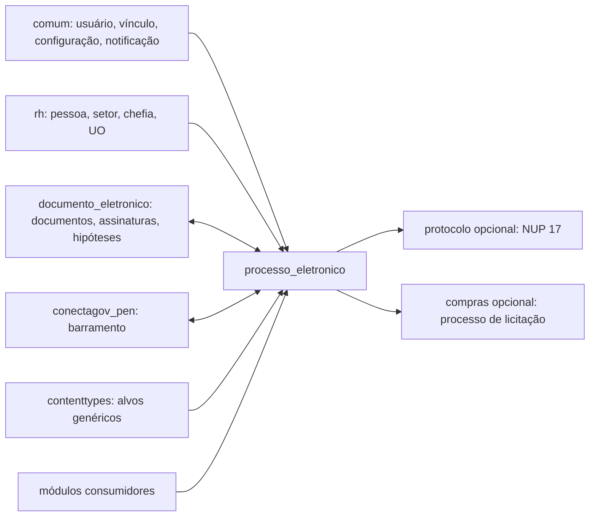

# Fronteira — processo_eletronico

O módulo é dono do ciclo de vida do processo, do trâmite, dos vínculos processuais e das solicitações específicas. Pessoas, vínculos, setores, documentos-base, barramento e compras permanecem em outros contextos.

## Dependências de entrada

| Módulo | Evidência/contrato consumido |
|---|---|
| `comum` | Usuário, `Vinculo`, `Configuracao`, setores de chefia, notificações, URL e unidade. |
| `rh` | `Pessoa`, `Setor`, `UnidadeOrganizacional`, função e histórico de chefia. |
| `documento_eletronico` | `DocumentoTexto`, `DocumentoDigitalizado`, `Assinatura`, `HipoteseLegal`, modelos e utilitários. |
| `conectagov_pen` | `envia_processo`, trâmites externos, recibos e pendências. |
| `contenttypes` | `GenericForeignKey` de anexos de juntada e alvos de alteração de acesso. |

## Dependências de saída

| Consumidor | Contrato publicado/uso observado |
|---|---|
| `compras` | Importa `Processo`; sinal do módulo cria `Compra` para tipo contendo `Licitação` quando configuração está ativa. |
| `contratos` | Relaciona contrato e processo eletrônico. |
| `dados_abertos` | Consulta/serializa dados de processo. |
| `edu` | Cria/consulta processos em fluxos acadêmicos. |
| `encceja` | Usa `Processo`. |
| `catalogo_provedor_servico` | Usa formulários, modelos e view de geração de processo para serviços. |
| `centralservicos` | Usa `CriarProcessoComTramiteForm`. |
| `pesquisa` | Usa processo em formulários e views. |
| `pgd2` | Usa processo em formulário. |
| `processmining` | Lê processo, status, tramitações e dados de finalização. |
| `plan_estrategico` | Cria/tramita processo e usa `Tramite`. |
| `professor_sv`, `professor_titular` | Criam/consultam/finalizam processos. |
| `progressao_docente`, `progressoes` | Geram processo eletrônico para progressão. |
| `rsc`, `rsc_tae` | Geram e vinculam processos. |
| `calculos_pagamentos` | Dependência declarada em `module_dependencies.json`; contrato específico não localizado neste inventário. ⚠️ REVISAR. |

Além dos módulos declarados, imports condicionais foram observados em `catalogo_provedor_servico`, `processmining`, `professor_sv`, `rsc_tae`, `conectagov_pen` e outros consumidores. ⚠️ REVISAR: manter `module_dependencies.json` sincronizado com imports dinâmicos.

## Contratos publicados

- Modelos públicos: `Processo`, `Tramite`, `TipoProcesso`, documentos processuais, `Requerimento` e solicitações.
- Métodos de domínio: `Processo.cadastrar_processo`, `Processo.pode_ler`, `Processo.pode_editar`, `Processo.alterar_nivel_acesso`, `Tramite.tramitar_processo` e `Tramite.receber_processo`.
- Rotas: nomes de `urls.py` para processos, caixa, tramitação, documentos, requerimentos, solicitações, acesso público e barramento.
- Sinais: `post_save` de `Processo` para compatibilidade NUP 17 e criação opcional de compra; `pre_save` de item de juntada para impedir inserção após expiração.
- Tasks: `Gerar Processo PDF`, `Gerar Zip do Processo` e `Criar Processo com Trâmite`.
- Configuração: namespace `comum.Configuracao`/`processo_eletronico` e modelo `ConfiguracaoProcessoEletronico`.

⚠️ REVISAR: não há versionamento formal dos contratos de métodos, rotas ou chaves de configuração; qualquer consumidor deve ser validado antes de alteração estrutural.

_Gerado/atualizado via subagent `documentador` em 2026-09-10._
