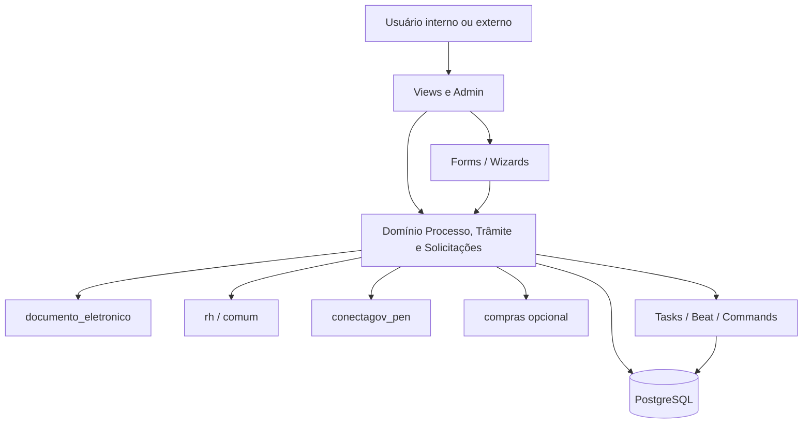
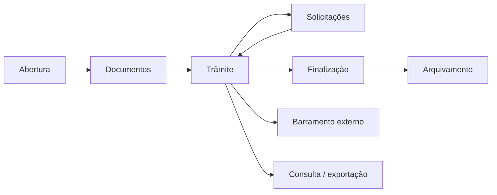

# HLA — processo_eletronico

High-Level Architecture do módulo Processos Eletrônicos. A descrição é baseada em `apps.py`, `models.py`, `views.py`, `forms.py`, `urls.py`, `admin.py`, `utils.py`, `tasks.py`, `beat.py`, sinais, templates, workflows, menu, permissões e `module_dependencies.json`.

## 1. Contexto e escopo

O módulo implementa o ciclo de vida de processos administrativos digitais: abertura, montagem documental, tramitação entre setores/pessoas, solicitações, finalização, arquivamento, consulta pública e integração externa. O processo é identificado por NUP 21 e pode manter referência a NUP 17 legado.

Fora do escopo do módulo: identidade, pessoas, vínculos, setores e unidades (`comum`/`rh`); tipos e conteúdo-base de documentos (`documento_eletronico`); transporte do barramento (`conectagov_pen`); processo de compras (`compras`). O módulo apenas publica/consome contratos desses contextos.

## 2. Estratégia de solução

| Decisão | Implementação observada | Consequência |
|---|---|---|
| Núcleo centrado em domínio | `Processo`, `Tramite`, documentos e solicitações em um `models.py` | Regras ficam próximas aos dados; arquivo grande e acoplado. |
| Interface Django server-rendered | Views, `FormPlus`, templates e Admin | Fluxos são transacionais e orientados a POST; não há API local. |
| Máquina de estados | FSM em `Processo`, ciência, juntada e solicitações | Transições impedem combinações inválidas, mas parte da semântica está espalhada em views/modelos. |
| Segurança por domínio | `pode_ler`, `pode_editar`, permissões Django, setor, vínculo e hipótese legal | Leitura pública e operação são decisões distintas. |
| Assinatura e integridade | Documento eletrônico, assinatura de trâmite, hashes e rotas de verificação | Conteúdo assinado é tratado como imutável. |
| Assíncrono seletivo | Tasks para PDF, ZIP e upload/criação | Evita bloquear requisições longas; exige armazenamento temporário/worker. |
| Compatibilidade incremental | Sinal para `protocolo`; integração opcional com `compras` e `conectagov_pen` | O comportamento varia conforme apps/configurações instalados. |

## 3. Blocos de construção

| Bloco | Responsabilidade | Contrato relevante |
|---|---|---|
| Processo | Identidade, status, acesso, interessados, relações e ciclo de vida | `Processo.pode_ler`, `pode_editar`, `cadastrar_processo`, transições FSM. |
| Trâmite | Remessa, recebimento, despacho, atribuição, prazos e distribuição | `Tramite.tramitar_processo`, `receber_processo`, `ultimo_tramite`. |
| Documentos | Vínculo lógico a documento texto/digital, minuta e assinatura | `DocumentoProcesso`, `ProcessoMinuta`. |
| Requerimentos | Pré-processo editável que gera processo ao finalizar | `Requerimento.cadastrar_processo`. |
| Solicitações | Ciência, juntada, despacho e alteração de nível | FSMs e notificações. |
| Permissões | Compartilhamento por setor/pessoa/poder de chefe e auditoria | `CompartilhamentoProcessoEletronico*`. |
| Apresentação | URLs autenticadas, consulta pública e Admin | `urls.py`, `views.py`, `menu.yaml`. |

## 4. Fluxos principais

| Fluxo | Entrada | Saída | Detalhe |
|---|---|---|---|
| Criar processo e primeiro trâmite | Dados, tipo, setor e papel | Processo `Em trâmite`, primeiro trâmite e documentos | [`criar-processo-e-primeiro-tramite.md`](fluxos/criar-processo-e-primeiro-tramite.md) |
| Receber e encaminhar | Trâmite pendente e operador autorizado | Trâmite recebido/novo trâmite | [`receber-e-encaminhar.md`](fluxos/receber-e-encaminhar.md) |
| Montar documentos | Documento interno ou upload | Vínculo documental assinado/validado | [`adicionar-documentos.md`](fluxos/adicionar-documentos.md) |
| Apensar/anexar | Processos visíveis e editáveis | Relação, anexação ou termo | [`relacionar-apensar-anexar.md`](fluxos/relacionar-apensar-anexar.md) |
| Solicitar ciência | Interessados e prazo | Solicitação e termo de ciência | [`solicitar-e-dar-ciencia.md`](fluxos/solicitar-e-dar-ciencia.md) |
| Solicitar juntada | Trâmite e destinatários | Documentos submetidos e avaliação | [`solicitar-e-avaliar-juntada.md`](fluxos/solicitar-e-avaliar-juntada.md) |
| Solicitar despacho | Processo encaminhável | Despacho deferido/indeferido ou cancelado | [`solicitar-e-deferir-despacho.md`](fluxos/solicitar-e-deferir-despacho.md) |
| Requerimento → processo | Requerimento finalizado e setor destino | Processo eletrônico com PDF e primeiro trâmite | [`finalizar-requerimento.md`](fluxos/finalizar-requerimento.md) |
| Finalizar/arquivar | Processo ativo/finalizado e permissões | Termo, status finalizado/arquivado | [`finalizar-e-arquivar.md`](fluxos/finalizar-e-arquivar.md) |
| Alterar acesso | Nível atual, novo nível e hipótese | Nível/solicitação/trâmite conforme regra | [`alterar-nivel-de-acesso.md`](fluxos/alterar-nivel-de-acesso.md) |
| Consulta e exportação | Processo legível ou consulta pública válida | Tela, PDF ou ZIP | [`consultar-e-exportar.md`](fluxos/consultar-e-exportar.md) |
| Gerenciar permissões | Chefia/poder de chefe e vínculos | Compartilhamentos sincronizados | [`gerenciar-permissoes.md`](fluxos/gerenciar-permissoes.md) |

Dependência entre fluxos: abertura antecede documentos e trâmite; ciência/juntada/despacho podem bloquear ou reabrir a tramitação; anexação/apensamento alteram as operações possíveis; finalização gera termo e pode desapensar; exportação sempre passa pela decisão de leitura.

## 5. Integrações

| Sistema/módulo | Direção | Uso |
|---|---|---|
| `comum` | Entrada/saída | Usuários, vínculos, configurações, notificações, unidades e consulta pública. |
| `rh` | Entrada/saída | Setor, unidade organizacional, cargos, chefias e pessoas. |
| `documento_eletronico` | Entrada/saída | Documento texto/digital, assinatura, classificação, hipótese legal e compartilhamento. |
| `conectagov_pen` | Entrada/saída | Envio externo, recibos, pendências e reativação. |
| `protocolo` | Saída opcional | Sinal sincroniza/cria processo irmão NUP 17. |
| `compras` | Saída opcional | Sinal cria compra quando o tipo contém `Licitação` e a configuração está ativa. |
| `contenttypes` | Entrada | Alvo polimórfico de solicitação de juntada e alteração de nível. |

## 6. Conceitos transversais

- **Acesso:** público, restrito e privado/sigiloso; a hipótese legal e o tipo de processo influenciam a transição.
- **Autorização:** permissões Django são necessárias, mas o domínio também exige setor, vínculo, chefia, poder de chefe, interessado ou cargo.
- **Auditoria:** `RegistroAcaoProcesso`, logs de comandos e log de compartilhamento; ações públicas podem depender de configuração.
- **Imutabilidade:** documentos/trâmites assinados não devem sofrer alteração; remoções de vínculo são lógicas.
- **Notificação:** `send_notification` é usado para recebimento, encaminhamento, finalização, arquivamento, solicitações, atribuição e permissões.
- **Tempo:** data/hora do domínio, prazos de recebimento, ciência, juntada e retorno programado.
- **Dados públicos:** UUID público e rotas públicas retornam apenas conteúdo autorizado; recaptcha é exigido quando a consulta muda.

## 7. Riscos e débito técnico

- `models.py` reúne 57 entidades e múltiplas responsabilidades; particionamento abaixo é inferido por relações/nome e requer validação de domínio.
- Há sintaxe de exceção legada (`except Processo.DoesNotExist, Tramite.DoesNotExist`) em `models.py`; ⚠️ REVISAR compatibilidade com o interpretador suportado antes de executar/importar o módulo.
- `urls.py` possui rotas duplicadas por finalidade pública/interna e endpoints sem `name`; ⚠️ REVISAR: catálogo automatizado de rotas.
- Chaves de `comum.Configuracao` não têm catálogo central; ⚠️ REVISAR: defaults, tipos e responsáveis.
- `SolicitacaoJuntada` contém função `todas_solicitacoes_juntada_concluiram` sem implementação observada; ⚠️ REVISAR regra esperada.
- `signals.py` acopla criação de processo a `compras` por substring `Licitação`; ⚠️ REVISAR contrato e idempotência.
- Geração de PDF/ZIP usa arquivos temporários; ⚠️ REVISAR limpeza em falha e observabilidade.
- Variantes de nomenclatura legada (`requirimento_pdf`, `procotolo_eletronico_post_save`) permanecem públicas; ⚠️ REVISAR compatibilidade antes de renomear.
- A matriz efetiva de acesso combina grupos e dados relacionais; ⚠️ REVISAR documentação de decisão e testes de autorização por URL.

## 8. Glossário

Ver [`GLOSSARIO.md`](GLOSSARIO.md). Termos centrais: processo, trâmite, interessado, vínculo, apensamento, anexação, ciência, juntada, despacho, minuta, NUP, nível de acesso e barramento.

_Gerado/atualizado via subagent `documentador` em 2026-09-10._
