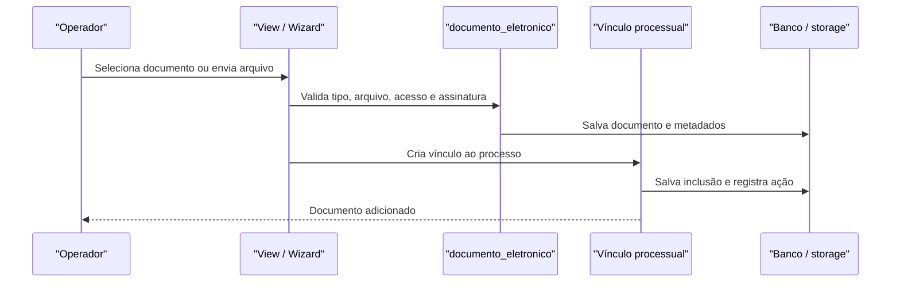

# Fluxo: adicionar documentos ao processo

**Atores:** Operador autorizado; signatário do documento.

**Gatilho:** ação “Adicionar documento”, inclusão de documento existente ou upload externo.

**Pré-condições:** processo legível/editável; documento interno finalizado quando for texto; arquivo em formato suportado; tipo/conferência/acesso e papel válidos.

**Pós-condições:** vínculo `DocumentoTextoProcesso` ou `DocumentoDigitalizadoProcesso` criado; upload externo gera e assina documento conforme formulário.

**Depende de:** `documento_eletronico`, `DocumentoUploadWizard`, `DocumentoTextoProcesso`, `DocumentoDigitalizadoProcesso` e permissões do processo.

**Habilita:** tramitação sem pendência documental, impressão e consulta do documento.

**Pontos de entrada no código:** `listar_documentos_adicionar`, `adicionar_documento_processo`, `documento_upload`, `DocumentoUploadWizard`, `Processo.adicionar_documento_texto`, `Processo.adicionar_documento_digitalizado`.

**Worker assíncrono:** upload via `criar_arquivos_e_primeiro_tramite_de_processo` pode converter e validar arquivos antes de persistir documentos.

**Observações:** o vínculo é removido logicamente, mantendo usuário, data, motivo e justificativa. Documento texto não finalizado é recusado. ⚠️ REVISAR: há uma mensagem de ação de documento digitalizado no caminho de inclusão que aparenta usar tipo de remoção; validar sem alterar retrocompatibilidade.

_Gerado/atualizado via subagent `documentador` em 2026-09-10._
