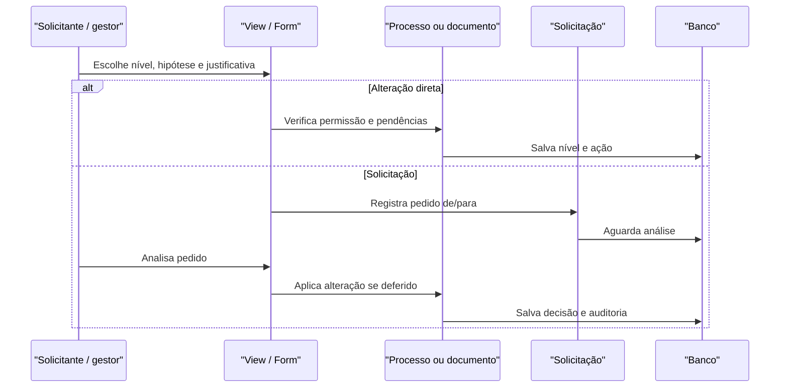

# Fluxo: alterar nível de acesso

**Atores:** usuário com permissão de alteração; gestor/analista de solicitações; solicitante de processo/documento.

**Gatilho:** alteração direta autorizada ou solicitação de alteração de nível.

**Pré-condições:** alvo legível; transição válida; hipótese legal quando exigida; nenhuma solicitação aberta para o alvo na alteração direta.

**Pós-condições:** nível/hipótese/justificativa salvos, registro de ação e trâmite adicional quando exigido; ou solicitação deferida/indeferida.

**Depende de:** `ProcessoFormAlterarNivelAcesso`, `Processo.alterar_nivel_acesso`, `SolicitacaoAlteracaoNivelAcesso`, `ConfiguracaoInstrucaoNivelAcesso` e `HipoteseLegal`.

**Habilita:** leitura/compartilhamento conforme novo nível e análise de documentos anteriormente restritos.

**Pontos de entrada no código:** `alterar_nivel_acesso_processo`, `solicita_alteracao_nivel_acesso_processo`, variantes de documento, `analisar_solicitacao_alteracao_nivel_acesso`, `indeferir_solicitacao_alteracao_nivel_acesso`.

**Worker assíncrono:** não há worker obrigatório; atualização periódica trata efeitos de status/termos relacionados.

**Observações:** público/restrito/privado alteram as regras de leitura; determinadas mudanças criam trâmite para setor/pessoa. A view bloqueia nova alteração enquanto houver solicitação aberta. ⚠️ REVISAR: matriz de analistas por grupo, setor e objeto polimórfico.

_Gerado/atualizado via subagent `documentador` em 2026-09-10._
