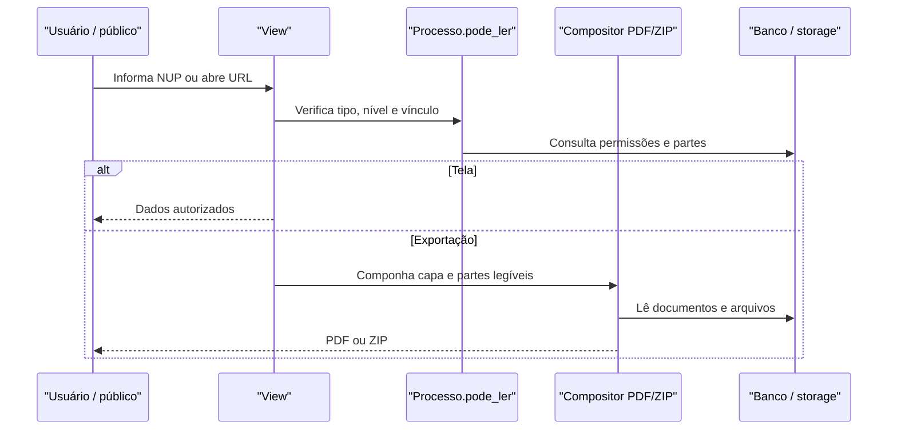

# Fluxo: consultar e exportar processo

**Atores:** usuário interno autorizado ou público anônimo em consulta pública.

**Gatilho:** abertura da tela do processo, busca por NUP, consulta pública, impressão ou download.

**Pré-condições:** usuário autenticado para rotas internas; consulta pública passa formulário/recaptcha quando parâmetros mudam; processo e partes podem ser lidos.

**Pós-condições:** tela/capa/conteúdo exibidos ou PDF/ZIP gerado contendo apenas partes autorizadas.

**Depende de:** `Processo.pode_ler`, UUID público, `ConsultaPublicaProcessoForm`, `gerar_partes_processo_pdf`, `gerar_processo_pdf`, `gerar_processo_zip`.

**Habilita:** consulta de trâmites, documentos, linha do tempo e impressão.

**Pontos de entrada no código:** `processo`, `processo_por_numero`, `consulta_publica`, `visualizar_processo`, `visualizar_capa_processo`, `tramite_conteudo`, `imprimir_processo`, `baixar_processo_zip` e variantes Celery.

**Worker assíncrono:** `Gerar Processo PDF` e `Gerar Zip do Processo` são tasks; views Celery acompanham `Task`/storage e retornam o arquivo.

**Observações:** consulta pública exige processo público cujo tipo permita consulta, salvo regra externa observada no código; recaptcha é exigido para nova consulta. ⚠️ REVISAR: política de exposição de dados básicos quando a parte completa não é legível.

_Gerado/atualizado via subagent `documentador` em 2026-09-10._
