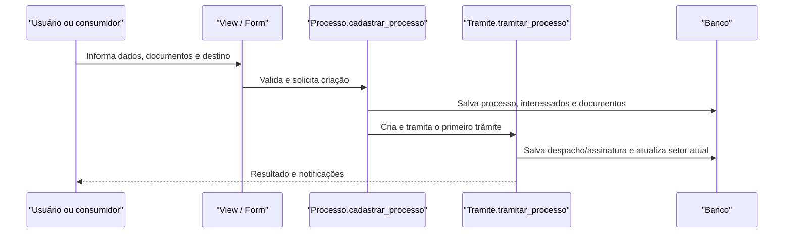

# Fluxo: criar processo e primeiro trâmite

**Atores:** Operador de Processo Eletrônico, Chefe de Setor ou integração consumidora.

**Gatilho:** cadastro direto do processo ou chamada de `Processo.cadastrar_processo`.

**Pré-condições:** usuário autenticado, setor/UO com código de protocolo, tipo de processo ativo, dados válidos, papel de assinatura quando necessário e destinatário do primeiro trâmite.

**Pós-condições:** processo criado com NUP, interessados e documentos informados; primeiro trâmite salvo e encaminhado.

**Depende de:** `TipoProcesso`, `comum.Vinculo`, `rh.Setor`, documentos e permissões de tramitação.

**Habilita:** recebimento pelo destino, edição conforme acesso e demais fluxos do processo.

**Pontos de entrada no código:** `views.processo`/Admin; `Processo.cadastrar_processo`; `Tramite.tramitar_processo`; `tasks.criar_arquivos_e_primeiro_tramite_de_processo`.

**Worker assíncrono:** a task converte DOC/DOCX/XLS/XLSX/CSV/imagens/PDF, verifica integridade e cria arquivos/trâmite; a criação síncrona usa o método de domínio.

**Observações:** o `save` do processo gera NUP 21 e pode disparar sinal para NUP 17 e/ou compras. Falha de código de protocolo do campus impede a geração. ⚠️ REVISAR: contrato de idempotência entre chamadas consumidoras e criação do primeiro trâmite.

_Gerado/atualizado via subagent `documentador` em 2026-09-10._
