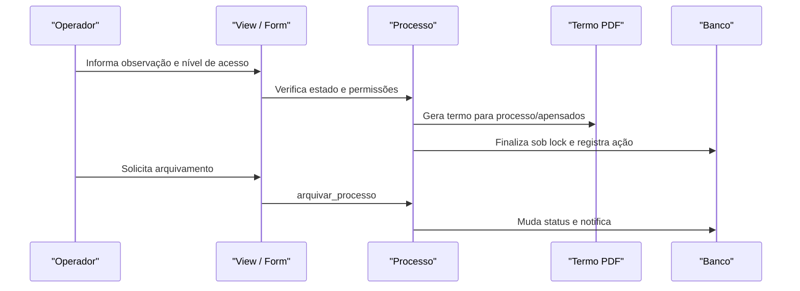

# Fluxo: finalizar e arquivar processo

**Atores:** operador/chefe autorizado a finalizar; usuário autorizado a arquivar.

**Gatilho:** ação de finalização no processo ativo; depois, ação de arquivamento no processo finalizado.

**Pré-condições:** processo legível; usuário pode finalizar; processo/apensados não possuem pendências impeditivas; dados de observação, acesso e hipótese válidos.

**Pós-condições:** termos de finalização são incluídos, apensamentos podem ser desfeitos, processo vira `Finalizado`; arquivamento muda para `Arquivado` e notifica.

**Depende de:** `Processo.finalizar_processo`, `Processo.arquivar_processo`, `ProcessoFormFinalizar`, PDFs de termo, lock transacional e notificações.

**Habilita:** arquivamento; desfinalização/reabertura por regra/autorização.

**Pontos de entrada no código:** `processo_finalizar`, `processo_desfinalizar`, `processo_arquivar`, `gerar_termo_finalizacao`, `Processo.finalizar_processo`, `Processo.arquivar_processo`.

**Worker assíncrono:** notificações são agendadas após commit; PDF completo posterior pode usar Celery.

**Observações:** a finalização trata processos apensados e gera termos; `LockError` e transição inválida são tratados pela view. O arquivamento exige processo finalizado. ⚠️ REVISAR: autorização detalhada da desfinalização/reativação.

_Gerado/atualizado via subagent `documentador` em 2026-09-10._
