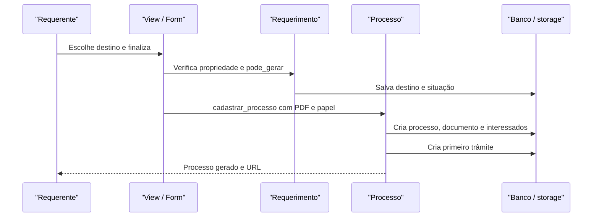

# Fluxo: finalizar requerimento e gerar processo

**Atores:** servidor, aluno, aposentado ou prestador autorizado a abrir requerimento.

**Gatilho:** requerente finaliza um requerimento editável.

**Pré-condições:** requerimento pertence ao usuário, tipo permite geração, destino definido, formulário válido e papel de assinatura disponível.

**Pós-condições:** requerimento finalizado; processo gerado, PDF do requerimento vinculado, documentos adicionados e primeiro trâmite criado.

**Depende de:** `Requerimento`, `RequerimentoFormCadastrar`, `FinalizarRequerimentoForm`, `TipoProcesso`, `Processo.cadastrar_processo` e `Tramite`.

**Habilita:** operação normal do processo eletrônico.

**Pontos de entrada no código:** `cadastrar_requerimento`, `gerenciar_requerimento`, `finalizar_requerimento`, `Requerimento.cadastrar_processo`.

**Worker assíncrono:** a montagem do PDF HTML ocorre na requisição; conversão de arquivos de processo pode ser delegada à task de criação.

**Observações:** o fluxo não permite edição de requerimento de outro usuário e não apaga requerimentos finalizados. ⚠️ REVISAR: origem e unicidade do número de requerimento são internas ao modelo, sem contrato separado neste documento.

_Gerado/atualizado via subagent `documentador` em 2026-09-10._
