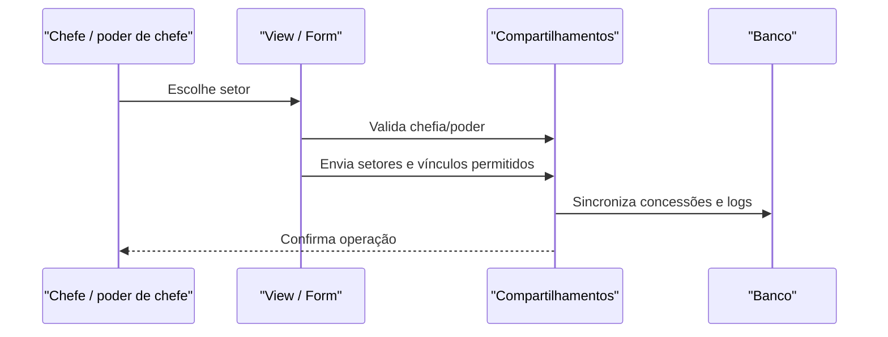

# Fluxo: gerenciar permissões do setor

**Atores:** Chefe de Setor ou servidor com poder de chefe; gerente sistêmico na configuração global.

**Gatilho:** acesso a “Permissões” para setor escolhido.

**Pré-condições:** usuário é chefe direto ou possui poder de chefe no setor; setores, vínculos e configurações existem.

**Pós-condições:** compartilhamentos de operar, criar/operar e retorno programado sincronizados; alterações auditadas e chefias notificadas quando aplicável.

**Depende de:** `iniciar_gerenciamento_compartilhamento`, `GerenciarCompartilhamentoProcessoForm`, modelos `CompartilhamentoProcessoEletronico*` e `Processo.atualizar_compartilhamentos`.

**Habilita:** membros autorizados operarem/criarem processos e cadastrarem retorno programado.

**Pontos de entrada no código:** `permissoes`, `gerenciar_compartilhamento_processos_poder_de_chefe`, `permissoes_processos_documentos`, `remover_permissao_processo_documento`.

**Worker assíncrono:** comando `processo_eletronico_atualizar_permissoes` atualiza permissões derivadas; sinal de função histórica atualiza poder de chefe de ofício.

**Observações:** a tela alerta quando a UO não possui código de protocolo. Setor escolhido por parâmetro também passa por verificação de chefia. ⚠️ REVISAR: precedência entre grupo Django, compartilhamento por setor/pessoa e poder de chefe.

_Gerado/atualizado via subagent `documentador` em 2026-09-10._
