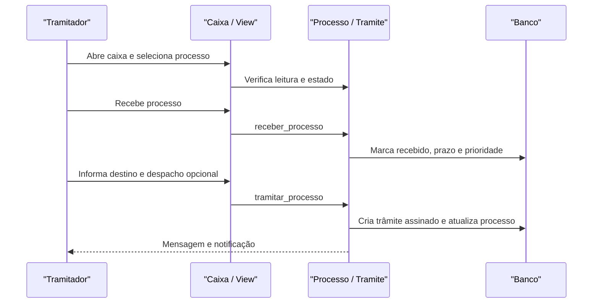

# Fluxo: receber e encaminhar processo

**Atores:** Tramitador, Operador, Chefe de Setor ou pessoa autorizada no destinatário.

**Gatilho:** processo aparece na Caixa de processos em “A Receber” ou “A Encaminhar”.

**Pré-condições:** usuário possui setor/vínculo autorizado; processo está legível; trâmite anterior existe; não há bloqueio documental ou de estado.

**Pós-condições:** recebimento grava usuário/data e prioridade padrão; encaminhamento grava novo trâmite, despacho opcional, assinatura e notificação.

**Depende de:** `Tramite.get_todos_setores`, `Processo.pode_ser_recebido`, `Processo.pode_ser_encaminhado`, `ModeloDespacho` quando há despacho.

**Habilita:** atribuição, atendimento, novo encaminhamento, solicitações e finalização.

**Pontos de entrada no código:** `selecao_caixa_processos`, `caixa_processos`, `processo_receber`, `processo_encaminhar`, `encaminhar_sem_despacho`, `Tramite.receber_processo`, `Tramite.tramitar_processo`.

**Worker assíncrono:** não há worker obrigatório para receber/encaminhar; PDF de despacho pode usar geração síncrona ou exportação assíncrona depois.

**Observações:** processo privado deve ser encaminhado para pessoa; a caixa admite filtros, abas e encaminhamento/recebimento em lote conforme configuração. Trâmites de processos apensados podem ser propagados. ⚠️ REVISAR: detalhar matriz de setor/pessoa da caixa por cenário de produção.

_Gerado/atualizado via subagent `documentador` em 2026-09-10._
