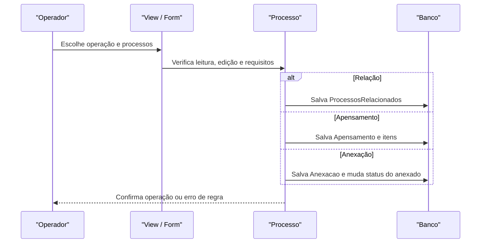

# Fluxo: relacionar, apensar e anexar processos

**Atores:** Operador/Chefe com permissão de edição dos processos.

**Gatilho:** usuário seleciona processo relacionado, apensado ou anexado na tela do processo.

**Pré-condições:** processos existentes, legíveis e editáveis; regras de nível de acesso, status, apensamento e documentos atendidas.

**Pós-condições:** relação informativa criada; ou apensamento criado; ou anexação registrada e processo anexado marcado `Anexado`.

**Depende de:** `ProcessosRelacionados`, `Apensamento`, `ApensamentoProcesso`, `Anexacao`, configuração `bloquear_processos_apensados`.

**Habilita:** consulta conjunta e propagação de determinadas ações; desapensamento desfaz o apensamento, mas anexação tem semântica própria.

**Pontos de entrada no código:** `listar_processos_relacionado`, `adicionar_processo_relacionado`, `apensar_processos`, `desapensar_processo`, `anexar_processos`, `Processo.apensar_processo`, `Processo.anexar_processo`.

**Worker assíncrono:** não há worker obrigatório; termos são gerados no fluxo síncrono.

**Observações:** o workflow BPMN `apensar_desapensar.bpmn` modela verificação de permissão e requisitos. O workflow `anexacao.bpmn` modela a checagem de documentos e a incorporação. ⚠️ REVISAR: cardinalidade histórica do apensamento e política de reversão da anexação.

_Gerado/atualizado via subagent `documentador` em 2026-09-10._
