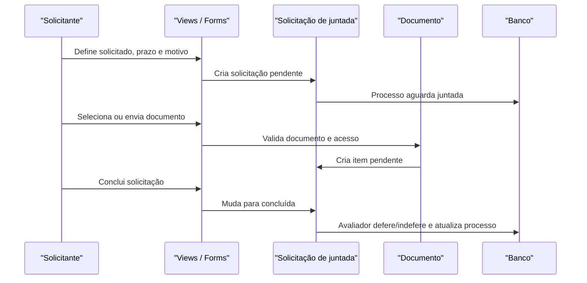

# Fluxo: solicitar e avaliar juntada de documentos

**Atores:** solicitante do processo; solicitado; avaliador/operador.

**Gatilho:** envio de pedido de juntada ou inclusão de documento em solicitação pendente.

**Pré-condições:** processo permite juntada; trâmite atual válido; solicitados, prazo e motivo preenchidos.

**Pós-condições:** solicitado anexa documento interno/externo e conclui; avaliador defere/indefere item; processo sai de pendência conforme os estados.

**Depende de:** `SolicitacaoJuntada`, `SolicitacaoJuntadaDocumento`, `SolicitacaoJuntadaStatus`, `ContentType` e vínculo processual de documentos.

**Habilita:** validação da juntada, retomada do trâmite ou permanência do documento fora do processo em caso de indeferimento.

**Pontos de entrada no código:** `enviar_solicitacao_juntada`, `listar_documentos_juntar`, `solicitar_juntada_documento_interno`, `solicitar_juntada_documento_externo`, `concluir_juntada_documento`, `deferir_solicitacao_juntada`, `indeferir_solicitacao_juntada`, `avaliar_solicitacao_juntada_documento`.

**Worker assíncrono:** comando periódico atualiza status geral e vencimento; não há worker de avaliação.

**Observações:** item deferido chama adição do documento ao processo; item indeferido registra parecer/justificativa. Inserção após expiração é bloqueada por `pre_save`. A função `todas_solicitacoes_juntada_concluiram` está sem implementação observada. ⚠️ REVISAR: regra agregadora e estado exato após múltiplos itens.

_Gerado/atualizado via subagent `documentador` em 2026-09-10._
