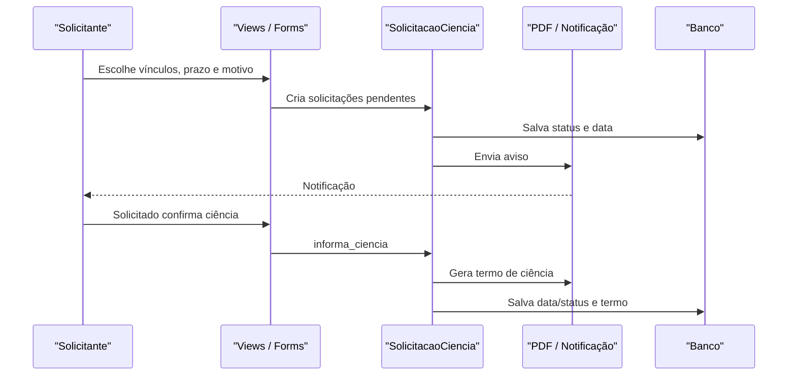

# Fluxo: solicitar e dar ciência

**Atores:** usuário autorizado no processo; vínculo solicitado; usuário externo/Gov.br quando aplicável.

**Gatilho:** solicitante escolhe interessados e prazo; solicitado acessa processo com ciência pendente.

**Pré-condições:** processo permite ciência; solicitados são vínculos válidos; prazo e motivo passam pelo formulário.

**Pós-condições:** `SolicitacaoCiencia` fica pendente e notifica; ao dar ciência, grava data/status e gera termo.

**Depende de:** `SolicitacaoCiencia`, `CienciaStatus`, `solicitar_ciencia`, `dar_ciencia`, PDF de ciência e notificação.

**Habilita:** retomada da tramitação quando todas as pendências aplicáveis forem tratadas.

**Pontos de entrada no código:** `views.solicitar_ciencia`, `views.dar_ciencia`, `SolicitacaoCiencia.informar_ciencia`, `SolicitacaoCiencia.gerar_termo_ciencia`.

**Worker assíncrono:** manutenção periódica atualiza ciência vencida e pode gerar termo de decurso conforme configuração.

**Observações:** o processo pode redirecionar diretamente para dar ciência quando há pendência para o vínculo. Ciência Gov.br usa formulário específico quando a sessão indica autenticação. ⚠️ REVISAR: política exata de expiração e “considerado ciente” deve ser confirmada com o responsável.

_Gerado/atualizado via subagent `documentador` em 2026-09-10._
