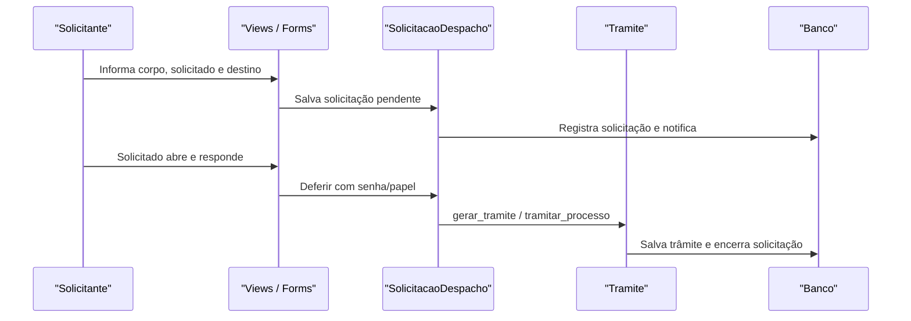

# Fluxo: solicitar e deferir despacho

**Atores:** solicitante do processo; pessoa solicitada a produzir despacho; setor/pessoa de destino.

**Gatilho:** usuário pede despacho para uma pessoa, com corpo e destino do trâmite.

**Pré-condições:** processo editável e encaminhável; não há solicitação de despacho pendente; existe `ModeloDespacho`.

**Pós-condições:** solicitação fica pendente; deferimento salva despacho, assina/gera trâmite e encaminha; indeferimento ou cancelamento encerra a solicitação.

**Depende de:** `SolicitacaoDespacho`, `SolicitacaoDespachoManager`, `ModeloDespacho`, `SolicitarDespachoForm` e `Tramite.tramitar_processo`.

**Habilita:** tramitação do processo pelo despacho produzido.

**Pontos de entrada no código:** `solicitar_despacho`, `solicitacao_despacho_visualizar`, `solicitacao_despacho_deferir`, `solicitacao_despacho_indeferir`, `solicitacao_despacho_cancelar`, `SolicitacaoDespacho.gerar_tramite`.

**Worker assíncrono:** não há worker obrigatório; notificações usam o serviço global.

**Observações:** a view impede nova solicitação se o processo não for encaminhável ou se faltar modelo. ⚠️ REVISAR: nomenclatura “solicitado”/“solicitante” no contrato externo e política de edição após envio.

_Gerado/atualizado via subagent `documentador` em 2026-09-10._
