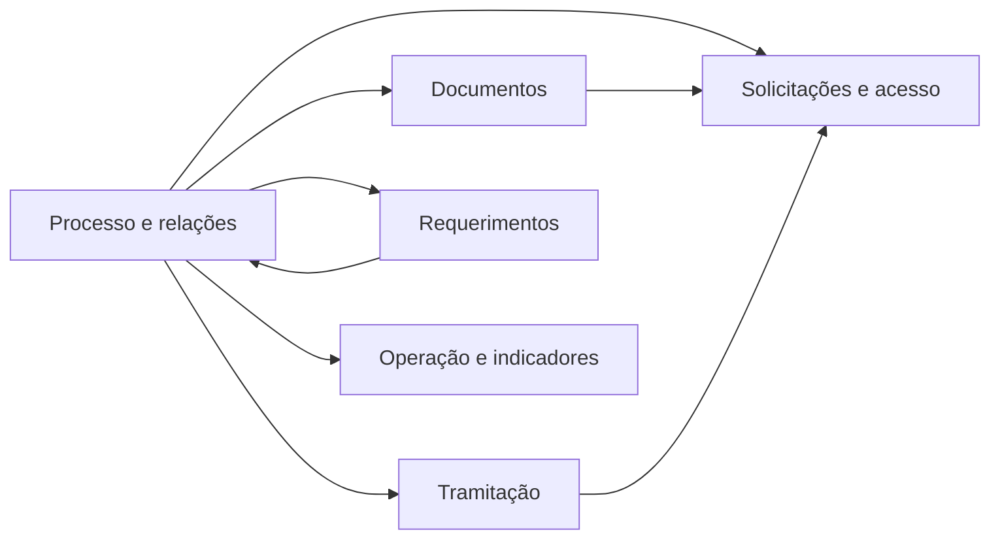

# Modelo de dados — processo_eletronico

`processo_eletronico/models.py` contém 57 entidades/base-modelos em um único arquivo. O ERD foi particionado para tornar as relações legíveis. Os agrupamentos abaixo são inferidos por nomes, relações e uso em views/admin; não há subpacotes de modelos que formalizem esses limites. ⚠️ REVISAR: validar os limites com o responsável pelo domínio.

| Subdomínio inferido | Arquivo | Entidades cobertas |
|---|---|---|
| Processo e relações | [`processo.md`](processo.md) | `HistoricoProcesso`, `Processo`, interessados, acompanhantes, relações, tipo, anexação, apensamento, comentários, grupos e reativação. |
| Tramitação | [`tramitacao.md`](tramitacao.md) | Rótulos, trâmite, prioridade, auditoria, notificações, ciência, assinatura, despacho, distribuição, retorno e prazo. |
| Documentos | [`documentos.md`](documentos.md) | Bases/vínculos de documentos, minutas, modelos e assinatura com anexação. |
| Requerimentos | [`requerimentos.md`](requerimentos.md) | Requerimento, documentos anexos e configuração do primeiro trâmite. |
| Solicitações e acesso | [`solicitacoes.md`](solicitacoes.md) | Juntada, item de juntada, instrução e alteração de nível. |
| Operação e indicadores | [`operacao-e-indicadores.md`](operacao-e-indicadores.md) | Configuração, compartilhamentos, logs e números. |

Regra de completude: cada uma das 57 classes de modelo, incluindo bases abstratas, aparece uma vez nos seis diagramas. ⚠️ REVISAR: conferir automaticamente a contagem ao alterar `models.py`.

Entidades externas recorrentes (`comum.Vinculo`, `comum.User`, `rh.Setor`, `rh.UnidadeOrganizacional`, `documento_eletronico.DocumentoTexto`, `documento_eletronico.DocumentoDigitalizado`, `documento_eletronico.Assinatura`, `documento_eletronico.Classificacao`, `documento_eletronico.HipoteseLegal`, `conectagov_pen.TramiteBarramento` e `contenttypes.ContentType`) aparecem como dependências, não como modelos pertencentes a este módulo.

_Gerado/atualizado via subagent `documentador` em 2026-09-10._
