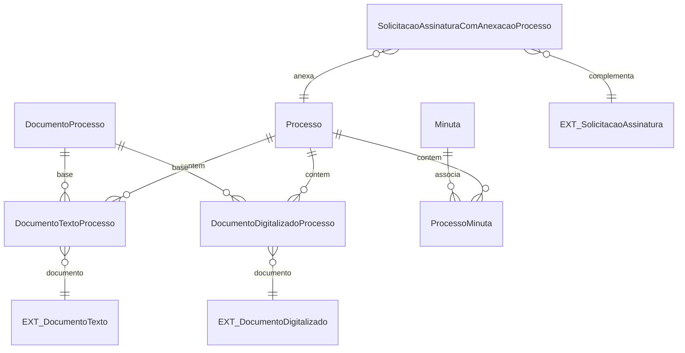

# Modelo de dados — documentos e minutas

Vínculos processuais e artefatos documentais. O conteúdo e a assinatura-base pertencem a `documento_eletronico`; este subdomínio registra a associação e artefatos específicos de processo.

| Entidade | Campos principais e relações |
|---|---|
| `DocumentoProcesso` | Base abstrata: `processo`, datas/usuários de inclusão e remoção, motivos e `justificativa_remocao`. |
| `DocumentoTextoProcesso` | Especializa a base e referencia `documento_eletronico.DocumentoTexto`. |
| `DocumentoDigitalizadoProcesso` | Especializa a base e referencia `documento_eletronico.DocumentoDigitalizado`. |
| `Minuta` | `uuid`, `assunto`, `corpo`, `cabecalho`, `rodape`, `data_criacao`, `documento` de texto. |
| `ProcessoMinuta` | `minuta`, `processo` e campos de inclusão/remoção, usuário e justificativa. |
| `SolicitacaoAssinaturaComAnexacaoProcesso` | `solicitacao_assinatura`, `processo_para_anexar`, `destinatario_setor_tramite`, `despacho_corpo`, `papel_solicitante`, `vinculo_para_distribuir`. |
| `ModeloDespacho` | `cabecalho`, `rodape`; usado para compor despachos. |

| Entidade externa | Uso |
|---|---|
| `documento_eletronico.DocumentoTexto` | Conteúdo textual, assinatura, finalização e identificador. |
| `documento_eletronico.DocumentoDigitalizado` | Arquivo, conferência, acesso e integridade. |
| `documento_eletronico.SolicitacaoAssinatura` | Solicitação-base complementada por anexação. |

_Gerado/atualizado via subagent `documentador` em 2026-09-10._
