# Modelo de dados — operação e indicadores

Configuração, concessão de operação, auditoria de comandos e agregados usados na administração/monitoramento.

```mermaid
erDiagram
    ConfiguracaoProcessoEletronico }o--o{ EXT_Setor : retorno_programado
    CompartilhamentoProcessoEletronicoSetorPessoa }o--|| EXT_Setor : dono
    CompartilhamentoProcessoEletronicoSetorPessoa }o--|| EXT_Vinculo : permitido
    CompartilhamentoProcessoEletronicoSetorSetor }o--|| EXT_Setor : dono
    CompartilhamentoProcessoEletronicoSetorSetor }o--|| EXT_Setor : permitido
    CompartilhamentoProcessoEletronicoPoderDeChefe }o--|| EXT_Setor : dono
    CompartilhamentoProcessoEletronicoPoderDeChefe }o--|| EXT_Vinculo : permitido
    CompartilhamentoProcessoEletronicoLog }o--|| EXT_Setor : dono
    CompartilhamentoProcessoEletronicoLog }o--o| EXT_Setor : permitido
    CompartilhamentoProcessoEletronicoLog }o--o| EXT_Vinculo : permitido
    NumerosProcessoEletronicoPorSetor }o--|| EXT_Setor : agrega
    NumerosProcessoEletronicoPorTipo }o--|| EXT_TipoProcesso : agrega
    NumerosProcessoEletronicoTempoPorTipo }o--|| EXT_UO : agrega
    NumerosProcessoEletronicoTempoPorTipo }o--|| EXT_TipoProcesso : agrega
```

| Entidade | Campos principais e relações |
|---|---|
| `ConfiguracaoProcessoEletronico` | M2M `setores_que_podem_cadastrar_retorno_programado`. Admin permite uma configuração. |
| `CompartilhamentoProcessoEletronicoSetorPessoa` | `setor_dono`, `vinculo_permitido`, `nivel_permissao`, data/usuário de criação. |
| `CompartilhamentoProcessoEletronicoSetorSetor` | `setor_dono`, `setor_permitido`, `nivel_permissao`, data/usuário de criação. |
| `CompartilhamentoProcessoEletronicoPoderDeChefe` | `setor_dono`, `vinculo_permitido`, data/usuário de criação, `de_oficio`. |
| `CompartilhamentoProcessoEletronicoLog` | Setor/pessoa permitidos (opcionais), setor dono, data/usuário, permissão e operação. |
| `LogCommandProcessoEletronico` | Início/fim, `sucesso`, `log`, `log_erro`, `comando`. |
| `NumerosProcessoEletronicoPorSetor` | `setor`, quantidades criadas e tramitadas. |
| `NumerosProcessoEletronicoPorTipo` | `tipo`, quantidade. |
| `NumerosProcessoEletronicoGeral` | Totais por situação e contadores de documentos. |
| `NumerosProcessoEletronicoTempoPorTipo` | UO, tipo, tempo médio e quantidade. |

| Entidade externa | Uso |
|---|---|
| `rh.Setor` / `rh.UnidadeOrganizacional` | Escopo de operação, retorno e agregação. |
| `comum.Vinculo` / `comum.User` | Pessoas autorizadas e autoria da mudança. |
| `processo_eletronico.TipoProcesso` | Agregação por tipo. |

⚠️ REVISAR: campos de agregação e constraints dos modelos `NumerosProcessoEletronico*` devem ser confirmados diretamente no banco antes de usar este desenho para migração.

_Gerado/atualizado via subagent `documentador` em 2026-09-10._
