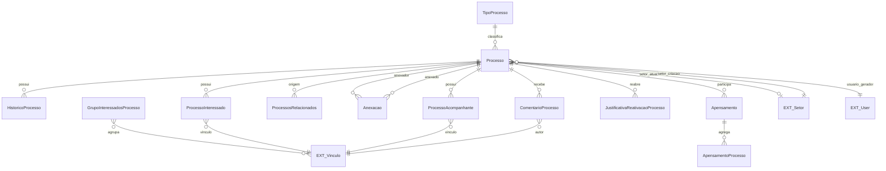

# Modelo de dados — processo e relações

Entidades responsáveis pela identidade, composição e relações entre processos. `DocumentoProcesso` e solicitações aparecem em outros diagramas; as entidades externas são apenas referências.

| Entidade | Campos principais e relações |
|---|---|
| `Processo` | `uuid`, `numero_protocolo`, `numero_protocolo_fisico`, `tipo_processo`, `assunto`, `nivel_acesso`, `hipotese_legal`, `status`, `data_hora_criacao`, `usuario_gerador`, `setor_criacao`, `modificado_por`, `ultima_modificacao`, `ultimo_tramite`, `setor_atual`, `data_finalizacao`, `usuario_finalizacao`, `observacao_finalizacao`; M2M `interessados`, `processos_relacionados`, `acompanhantes_processo`. |
| `HistoricoProcesso` | `processo`, `data_hora`, `usuario`, `tipo`, `descricao`. |
| `ProcessoInteressado` | Associativa de `processo` e `vinculo`; participa do M2M de interessados. |
| `ProcessoAcompanhante` | Associativa de `processo` e `vinculo`; participa do M2M de acompanhantes. |
| `ProcessosRelacionados` | `processo_origem`, `processo_alvo`; relação com unicidade declarada. |
| `TipoProcesso` | `nome`, flags de acesso (`permite_acesso_publico`, `permite_acesso_restrito`, `permite_acesso_privado`), `nivel_acesso_default`, classificações, `permite_gerar_processo_via_requerimento`, `orientacoes_requerimento`, `consulta_publica`, `ativo`. |
| `Anexacao` | `processo_anexador`, `processo_anexado`, datas/usuários de criação e remoção, justificativas e `termo_juntada_documentotexto`. |
| `Apensamento` | Datas, usuários e justificativas de criação/remoção do agrupamento. |
| `ApensamentoProcesso` | `apensamento`, `processo`, datas, usuários e justificativas de criação/remoção. |
| `ComentarioProcesso` | `processo`, `vinculo`, `comentario`, `desconsiderado_em`, `data`. |
| `GrupoInteressadosProcesso` | `nome`, M2M `interessados` (`comum.Vinculo`), `usuario`. |
| `JustificativaReativacaoProcesso` | `tramite`, `justificativa`, data e usuário. A relação com processo é indireta pelo trâmite. |

| Entidade externa | Uso |
|---|---|
| `comum.Vinculo` | Interessado, acompanhante, autor de comentário e membros de grupo. |
| `comum.User` | Usuários de criação, alteração e histórico. |
| `rh.Setor` | Setor de criação e setor atual. |
| `documento_eletronico.HipoteseLegal` | Hipótese legal do processo. |

⚠️ REVISAR: a relação de `Apensamento` com `Processo` é materializada por `ApensamentoProcesso`; cardinalidade histórica e regras de remoção devem ser confirmadas no domínio.

_Gerado/atualizado via subagent `documentador` em 2026-09-10._
