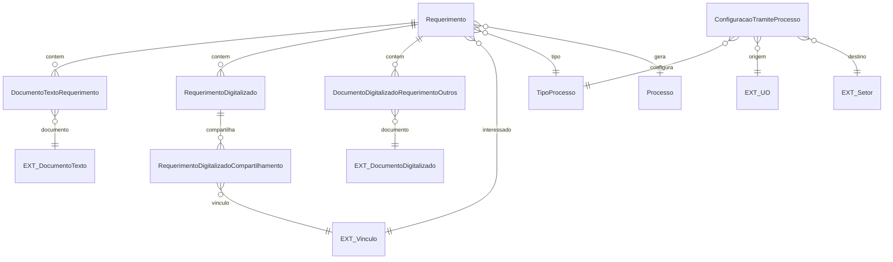

# Modelo de dados — requerimentos

Pré-processo usado para receber dados do requerente, documentos e destino antes da geração de um processo eletrônico.

| Entidade | Campos principais e relações |
|---|---|
| `Requerimento` | `interessado`, `tipo_processo`, `hipotese_legal`, `assunto`, `descricao`, `destinatario_setor`, `situacao`, datas de início/finalização/cancelamento, `processo`. |
| `DocumentoTextoRequerimento` | `requerimento`, `documento`, `data`. |
| `RequerimentoDigitalizado` | `requerimento`, arquivo, tipo de documento, assunto, nível de acesso, hipótese legal, tipo de conferência, identificadores, data, M2M `sharing` via compartilhamento. |
| `RequerimentoDigitalizadoCompartilhamento` | `requerimentodigitalizado`, `vinculo`. |
| `DocumentoDigitalizadoRequerimentoOutros` | `documento`, `requerimento`, `data_hora_cadastro`; pode ser anexado ao processo gerado. |
| `ConfiguracaoTramiteProcesso` | `tipo_processo`, `uo_origem_interessado`, `setor_destino_primeiro_tramite`. |

| Entidade externa | Uso |
|---|---|
| `comum.Vinculo` | Requerente e compartilhamento de documentos. |
| `rh.Setor` / `rh.UnidadeOrganizacional` | Destino e configuração do primeiro trâmite. |
| `documento_eletronico.DocumentoTexto` / `DocumentoDigitalizado` | Conteúdo dos documentos do requerimento. |

O fluxo de finalização usa `Requerimento.cadastrar_processo`: gera processo, vincula o requerimento, adiciona o PDF do requerimento/documentos e cria o primeiro trâmite.

_Gerado/atualizado via subagent `documentador` em 2026-09-10._
