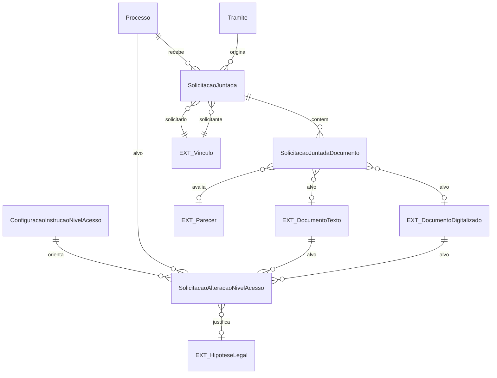

# Modelo de dados — solicitações e níveis de acesso

Entidades que suspendem/liberam a tramitação ou alteram o acesso a processos/documentos.

| Entidade | Campos principais e relações |
|---|---|
| `SolicitacaoJuntada` | `tramite`, `status`, `solicitante`, `motivo`, `data_limite`, `data_solicitacao`, `solicitado`, `data_conclusao`, dados de cancelamento. |
| `SolicitacaoJuntadaDocumento` | `solicitacao_juntada`, `status`, `motivo`, `parecer`, datas/usuário de avaliação, data do pedido e alvo polimórfico por `content_type`/`object_id` (`DocumentoTexto` ou `DocumentoDigitalizado`). |
| `ConfiguracaoInstrucaoNivelAcesso` | `orientacao`, `ativo`; fornece instruções gerais no formulário de deferimento. |
| `SolicitacaoAlteracaoNivelAcesso` | Alvo polimórfico processo/documento, usuário/data da solicitação, descrição, níveis de/para, hipótese legal, analista/data, situação, `deferido_pela_solicitacao`. |

| Entidade externa | Uso |
|---|---|
| `comum.Vinculo` / `comum.User` | Solicitantes, solicitados e analistas. |
| `documento_eletronico.DocumentoTexto` / `DocumentoDigitalizado` | Documentos juntados e alvos de alteração de nível. |
| `documento_eletronico.HipoteseLegal` | Justificativa legal do novo nível. |
| `contenttypes.ContentType` | Resolução do alvo polimórfico da juntada/alteração. |
| `Tramite` / `Processo` | Contexto processual da solicitação. |

Estados observados: juntada `Pendente`, `Concluída pelo solicitado`, `Finalizada`, `Expirada`, `Cancelada`; item `Pendente`, `Deferida`, `Indeferida`; alteração de acesso `Solicitado`, `Deferido`, `Indeferido`.

_Gerado/atualizado via subagent `documentador` em 2026-09-10._
