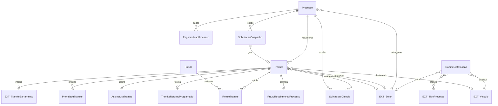

# Modelo de dados — tramitação

Entidades de encaminhamento, recebimento, despacho, ciência, atribuição, distribuição, prazos e auditoria operacional.

| Entidade | Campos principais e relações |
|---|---|
| `Tramite` | `processo`, `uuid`, datas de encaminhamento/recebimento, `despacho_cabecalho`, `despacho_corpo`, `despacho_rodape`, `recebido_por`, remetente (`remetente_setor`, `remetente_vinculo`), destinatário (`destinatario_setor`, `destinatario_vinculo`), atribuição (`atribuido_para`, `atribuido_por`, `atribuido_em`), `em_atendimento`, `atendido`, `tramite_barramento`. |
| `Rotulo` | `cor`, `legenda`, `descricao`, `setor`, `ativo`. |
| `RotuloTramite` | Associativa `rotulo`–`tramite`. |
| `PrioridadeTramite` | `tramite`, `prioridade`, `justificativa`, data e usuário de criação. |
| `RegistroAcaoProcesso` | `processo`, `user`, `date`, `ip`, `type`, `observation`. |
| `Notificao` | Base abstrata: `processo`, `tramite`, `solicitante`, `solicitado`, `data_solicitacao`, `motivo`. |
| `SolicitacaoCiencia` | Especializa `Notificao`; `data_ciencia`, `data_limite_ciencia`, `tipo`, `data_limite_juntada`, `status` e dados de cancelamento. |
| `AssinaturaTramite` | Relação entre assinatura de `documento_eletronico` e `tramite`. |
| `SolicitacaoDespacho` | `processo`, status, motivo de rejeição, corpo/cabeçalho/rodapé, datas de solicitação/resposta, destino setor/vínculo, `tramite_gerado`, remetente e `solicitado`. |
| `TramiteDistribuicao` | `setor`, `distribuir_para`, M2M `tipos_processos_atendidos`. |
| `TramiteRetornoProgramado` | `tramite_gerador`, `data_prevista_retorno`, `data_efetiva_retorno`, `tramite_retorno`. |
| `PrazoRecebimentoProcesso` | `tramite`, `limite`, `decorrido`. |

| Entidade externa | Uso |
|---|---|
| `comum.Vinculo` | Solicitante, solicitado, remetente, destinatário, atribuição e distribuição. |
| `rh.Setor` | Origem/destino, rótulo e distribuição. |
| `documento_eletronico.Assinatura` | Assinatura do trâmite. |
| `conectagov_pen.TramiteBarramento` | Estado/recibo do trâmite externo. |

⚠️ REVISAR: o campo `tramite_barramento` e a cardinalidade de `TramiteRetornoProgramado` dependem de modelos/relacionamentos externos não definidos neste arquivo.

_Gerado/atualizado via subagent `documentador` em 2026-09-10._
