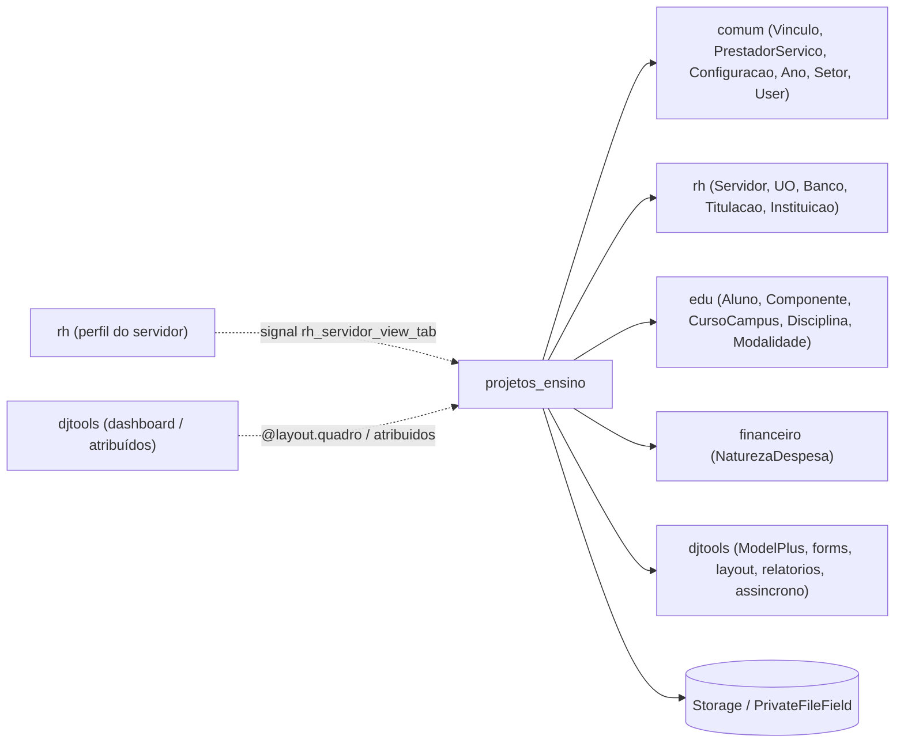

# Fronteiras — Projetos de Ensino

> Superfície do módulo: o que entra, o que sai e os contratos com o resto do SUAP.
> Complementa o [HLA.md](HLA.md) (§1 contexto, §5 integrações).

## Mapa

## Dependências de entrada (inbound)

Verificado com `grep -rlE "import projetos_ensino|from projetos_ensino" --include='*.py'`
(excluindo o próprio módulo e `migrations/`): só os arquivos do próprio app
(`admin.py`, `forms.py`, `urls.py`, `views.py`, `tests/`, `features/`) referenciam
`projetos_ensino`.

| Módulo consumidor | O que consome | Acoplamento |
|---|---|---|
| — | — | — |

_Ninguém depende deste módulo:_ `_N/A — folha_`

> Observação: o `rh` aciona indiretamente o módulo via o signal `rh_servidor_view_tab`
> (este módulo é **ouvinte**, não importado por `rh`). Ver "Contratos publicados".

## Dependências de saída (outbound)

Confirmado contra `module_dependencies.json` (`["comum", "financeiro", "rh", "edu"]`).

| Depende de | O quê | Tipo |
|---|---|---|
| `comum` | `Vinculo`, `PrestadorServico`, `Ano`, `Setor`, `User`, `Configuracao`, `Arquivo`, `UsuarioGrupo`, `forms` | módulo interno |
| `rh` | `Servidor`, `UnidadeOrganizacional`, `Banco`, `Titulacao`, `Instituicao`; signal `rh.views.rh_servidor_view_tab` | módulo interno |
| `edu` | `Aluno`, `Componente`, `CursoCampus`, `Disciplina`, `Modalidade`, `NivelEnsino` | módulo interno |
| `financeiro` | `NaturezaDespesa` | módulo interno |
| `djtools` | `ModelPlus`/campos, `forms`, `layout`, `relatorios`, `assincrono` (task), `utils` (PDF/XLS, `permission_required`, `rtr`, `httprr`), `templatetags` | framework SUAP |
| Storage (MinIO/FileField) | `PrivateFileField` (editais, anexos, comprovantes, fotos, termos, documentação) | integração de armazenamento |

## Contratos publicados

O que outros módulos podem acoplar a este (mude com cuidado):

- **Signals ouvidos:** `@receiver(rh_servidor_view_tab)` → `servidor_view_tab_participacoes_signal` (`views.py:4091`). Recebe `(sender, request, servidor, verificacao_propria, eh_chefe)` do `rh` e renderiza `projetos_ensino/templates/servidor_view_tab.html` com as participações do servidor em projetos aprovados. Contrato: assinatura do signal e o template.
- **Widget de dashboard:** `@layout.quadro('Projetos de Ensino', ...)` → `index_quadros` (`views.py:332`). Exibe editais abertos e contadores de pendência no dashboard do SUAP (consumido pelo framework `djtools.layout`).
- **Itens "atribuídos":** `@layout.atribuidos_a_meus_grupos()` (`index_atribuidos_a_meus_grupos`), `@layout.atribuidos_a_mim()` (`index_atribuidos_a_mim`) e `@layout.info()` — alimentam as caixas de pendências do usuário.
- **Tasks Celery:** 5 tasks de exportação XLS (`tasks.py`) — consumidas internamente pelas views de relatório; nenhum outro app depende delas.
- **Models reusados por outros módulos:** nenhum (módulo folha).
- **Permissões publicadas:** custom em `Projeto.Meta.permissions` (`pode_gerenciar_edital`, `pode_avaliar_projeto`, `pode_pre_avaliar_projeto`, `pode_monitorar_projeto`, `pode_interagir_com_projeto`, etc.) e grupos em `permissions.yaml` — base do `menu.yaml`.
- > ⚠️ REVISAR: o signal entrega HTML pronto (template do próprio app) para ser embutido no perfil de servidor do `rh` — acoplamento de apresentação implícito (mudança no template do `rh`/layout do perfil pode quebrar a aba sem erro de import).

---
_Gerado/atualizado via subagent `documentador` em 2026-06-19._
