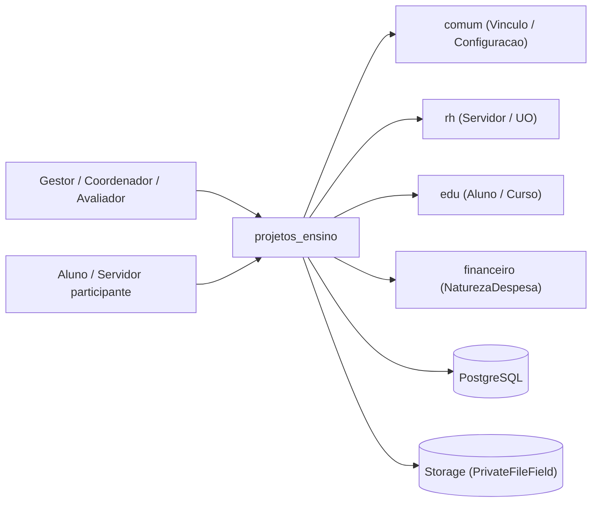
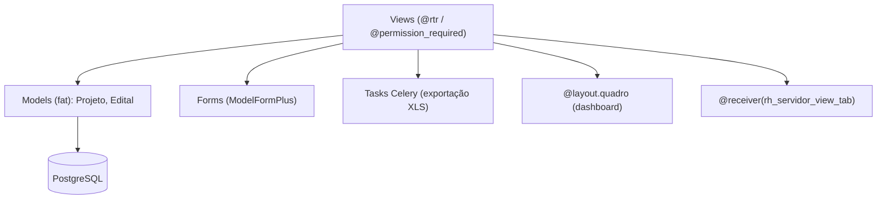
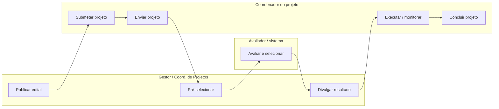

# HLA — Projetos de Ensino

> High Level Architecture. Complementa o [README.md](README.md). Foco em contexto, blocos, fluxo e riscos. Baseado em arc42 (enxuto) + C4 + Mermaid.

## 1. Contexto e escopo

`projetos_ensino` é um app de domínio da área "Ensino" que orquestra o ciclo de vida de
projetos de ensino. É usado por gestores, coordenadores de projeto (servidores/alunos),
pré-avaliadores, avaliadores e monitores. Troca dados com `comum` (vínculos, prestadores,
configuração), `rh` (servidores, campi, bancos, titulações, instituições), `edu`
(alunos, cursos, disciplinas) e `financeiro` (naturezas de despesa). É um app **folha**:
nenhum outro app do SUAP o importa.

> Atores definidos em [README.md → Atores e papéis](README.md#atores-e-papéis).

## 2. Estratégia de solução

| Decisão | Escolha | Motivo |
|---|---|---|
| Persistência | `ModelPlus` / PostgreSQL | Padrão SUAP (`djtools.db`) |
| Regras de negócio | Fat models | Máquina de estados e elegibilidade vivem em `Projeto`/`Edital` (`pode_*`, `get_status`, `classifica_projetos_extensao`) |
| Estado do projeto | Derivado do calendário do edital + flags | `get_periodo`/`get_status` calculam o estado em tempo de leitura a partir das datas do `Edital` e de `pre_aprovado`/`aprovado`/conclusão (não há campo `status` persistido) |
| Processamento assíncrono | Celery só para exportação | 5 tasks XLS (`djtools.assincrono`); o domínio é síncrono |
| Apresentação | Views funcionais `@rtr` + templates | Django clássico; sem django-ninja |
| Permissões | Grupos (`permissions.yaml`) + papéis relacionais | Mistura de `@permission_required` e checagens em runtime (coordenador/monitor por FK) |

## 3. Blocos de construção (componentes internos)

| Componente | Responsabilidade |
|---|---|
| Views/Forms | Entrypoints das URLs; validação de período/permissão; condução do workflow e geração de PDFs/relatórios |
| Models (fat) | Entidades + regras de negócio + máquina de estados (`Projeto`, `Edital`, `Participacao`, `Avaliacao`) |
| Tasks | Exportação de relatórios para XLS (somente leitura) |
| Contratos de UI | Widget de dashboard e aba no perfil do servidor (consumidos por `djtools`/`rh`) |

Modelo de dados (ERD): ver [modelo-de-dados/](modelo-de-dados/).

## 4. Fluxos principais

Cada fluxo feliz importante tem arquivo próprio em `docs/fluxos/`. Os mais centrais primeiro.

| Fluxo | Ator | Gatilho | Doc |
|---|---|---|---|
| Publicar edital | Gestor / Coord. de Projetos | Cadastro do edital + critérios/recursos/ofertas (admin + `/edital/<id>/`) | [fluxos/publicar-edital.md](fluxos/publicar-edital.md) |
| Submeter projeto | Coordenador do projeto | `POST /adicionar_projeto/<edital_id>/` | [fluxos/submeter-projeto.md](fluxos/submeter-projeto.md) |
| Enviar projeto | Coordenador do projeto | `POST /concluir_planejamento/<projeto_id>/` | [fluxos/enviar-projeto.md](fluxos/enviar-projeto.md) |
| Pré-selecionar projeto | Pré-avaliador / Coord. de Projetos | `GET /pre_selecionar/<projeto_id>/` (e `pre_aprovar`/`pre_rejeitar`) | [fluxos/pre-selecionar-projeto.md](fluxos/pre-selecionar-projeto.md) |
| Avaliar e selecionar projeto | Avaliador / sistema | `POST /avaliar/<projeto_id>/` → classificação | [fluxos/avaliar-selecionar-projeto.md](fluxos/avaliar-selecionar-projeto.md) |
| Divulgar resultado | Coord. de Projetos / sistema | `GET /divulgar_resultado_edital/<edital_id>/<periodo>/` | [fluxos/divulgar-resultado.md](fluxos/divulgar-resultado.md) |
| Executar e monitorar projeto | Coordenador do projeto + Monitor | Registro de atividades/gastos + validação | [fluxos/executar-monitorar-projeto.md](fluxos/executar-monitorar-projeto.md) |
| Concluir projeto | Coordenador do projeto + Monitor | `POST /finalizar_conclusao/<projeto_id>/` + `avaliar_conclusao_projeto` | [fluxos/concluir-projeto.md](fluxos/concluir-projeto.md) |

### Mapa de fluxos (raias por ator)

Os fluxos formam uma cadeia (cada um habilita o próximo). Raias = ator principal.

## 5. Integrações

| Integração | Direção | Como | Onde |
|---|---|---|---|
| `comum` (Vinculo, PrestadorServico, Ano, Setor, User, Configuracao) | out | Import direto / FK | `models.py`, `views.py` |
| `rh` (Servidor, UnidadeOrganizacional, Banco, Titulacao, Instituicao) | out | Import direto / FK | `models.py` |
| `edu` (Aluno, Componente, CursoCampus, Disciplina) | out | Import direto / M2M-FK | `models.py` |
| `financeiro` (NaturezaDespesa) | out | Import direto / FK | `models.py` |
| `rh.views.rh_servidor_view_tab` | in (signal) | `@receiver` renderiza aba no perfil do servidor | `views.py` (`servidor_view_tab_participacoes_signal`) |
| `djtools.layout` | out | Widget de dashboard (`@layout.quadro`), itens de "atribuídos" | `views.py` |
| Storage (MinIO/FileField) | out | `PrivateFileField` (editais, anexos, comprovantes, fotos, termos) | vários models |

Mapa completo de fronteira (dependências inbound/outbound + contratos): ver
[FRONTEIRA.md](FRONTEIRA.md).

## 6. Conceitos transversais

- **Transações:** `@transaction.atomic` em `Edital.save`, `Projeto.save`, `Projeto.clonar_projeto`.
- **Locks / concorrência:** sem lock distribuído; o "estado" é derivado em runtime do calendário, não persistido — leituras concorrentes são consistentes, mas há janelas de corrida na escrita de `pre_aprovado`/`aprovado` (sem trava explícita). ⚠️ REVISAR.
- **Storage:** `PrivateFileField` para arquivos do edital, anexos da equipe, comprovantes de gasto, fotos (com thumbnail PIL) e termos de cessão.
- **Permissões:** grupos definidos em `permissions.yaml` + permissões custom no `Meta` de `Projeto` (`pode_gerenciar_edital`, `pode_avaliar_projeto`, ...) + papéis relacionais (coordenador via `Participacao.responsavel`, monitor via `Projeto.vinculo_monitor`).
- **Auditoria:** históricos de domínio (`HistoricoEquipe`, `ProjetoHistoricoDeEnvio`, `HistoricoAlteracaoPeriodoProjeto`, `HistoricoOrientacaoProjeto`) — não usa `LogModel` genérico.

## 7. Riscos e débito técnico

- **Bug latente — `Edital.EXTENSAO` inexistente.** `Projeto.pode_mostrar_dados_selecao()` (`models.py:1489`) compara `self.edital.tipo_edital == Edital.EXTENSAO`, mas `Edital` só define `ENSINO`, `ENSINO_CONTINUO`, `CAMPUS`, `GERAL`, `TEMA` — **não existe** `EXTENSAO` (resquício de código copiado de extensão/pesquisa). Sempre que o método for chamado, levanta **`AttributeError`**. ⚠️ REVISAR: corrigir para a constante correta ou remover o método.
- **Falha de autorização — `divulgar_resultado_edital` sem `@permission_required`.** A view (`views.py:3367`) tem apenas `@rtr()`, ao contrário do sibling `resultado_edital` (gated por `pode_interagir_com_projeto`). Qualquer usuário autenticado pode acessar `/divulgar_resultado_edital/<edital_id>/<periodo>/` e ver o resultado divulgado antes/independentemente da permissão. ⚠️ REVISAR: adicionar `@permission_required('projetos_ensino.pode_interagir_com_projeto')`.
- **Task de exportação sem `return` — `relatorio_caracterizacao_beneficiarios_to_xls`.** Em `tasks.py:121` o `XlsResponse(...)` é construído mas **não retornado** (diferente das outras 4 tasks). O download da exportação de caracterização de beneficiários não produz arquivo. ⚠️ REVISAR.
- **Acoplamento por nome de origem de recurso.** `Projeto.get_plano_aplicacao_como_dict()` filtra `Recurso.origem` por strings literais `'PROEX'`/`'DIGAE'`/`'CAMPUS'` — frágil a divergência de cadastro.
- **Complexidade da máquina de estados.** `get_status`/`get_periodo`/`get_pre_selecionado`/`get_selecionado` são grandes e duplicam ramos `ENSINO`/`ENSINO_CONTINUO`; difícil de evoluir com segurança.

## 8. Glossário

Linguagem ubíqua, siglas e mapa entidade↔negócio: ver [GLOSSARIO.md](GLOSSARIO.md).

---
_Gerado/atualizado via subagent `documentador` em 2026-06-19._
