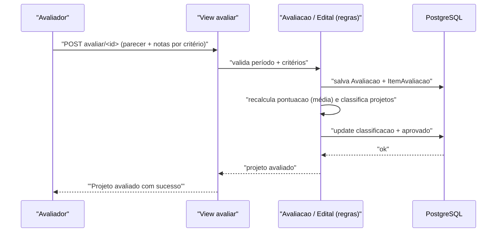

# Fluxo: Avaliar e selecionar projeto

> Os avaliadores indicados pontuam os projetos pré-selecionados por critério; o sistema classifica e seleciona os melhores até o limite da oferta.

- **Ator(es):** Avaliador de Projetos de Ensino (humano) + sistema (classificação) — ver [README → Atores e papéis](../README.md#atores-e-papéis)
- **Gatilho:** `POST /projetos_ensino/avaliar/<projeto_id>/`
- **Pré-condições:** Edital em período de seleção (`Edital.is_periodo_selecao()`); critérios de avaliação cadastrados; avaliador indicado ao projeto (`AvaliadorIndicado`). Aplica-se a editais `ENSINO` (não `ENSINO_CONTINUO`).
- **Pós-condições:** `Avaliacao` (única por projeto+avaliador) com `ItemAvaliacao` por critério; `Projeto.pontuacao` recalculada como **média** das avaliações; `Edital.classifica_projetos_extensao()` atualiza `classificacao` e marca `aprovado` até `qtd_selecionados`/ponto de corte.
- **Depende de:** [Pré-selecionar projeto](pre-selecionar-projeto.md)
- **Habilita:** [Divulgar resultado](divulgar-resultado.md)
- **Entrada no código:** view `avaliar` (`views.py:1284`); `Avaliacao.save`, `Edital.classifica_projetos_extensao`

## Sequência

## Observações

- Projeto com **uma única** avaliação fica com `pontuacao = 0` e `aprovado = False` (regra em `Avaliacao.pontua_projetos_extensao`).
- Desempate: ordenação por `pontuacao` e pela soma de pontos por critério na `ordem_desempate`.
- A indicação de avaliadores é um pré-fluxo de gestão (`editais_para_avaliacao` → `selecionar_avaliadores`), com `pode_ver_nome_avaliador` restrito ao gestor.
- O gestor pode alterar notas via `alterar_ficha_avaliacao` (guarda `pontuacao_original`).

---
_Gerado/atualizado via subagent `documentador` em 2026-06-19._
