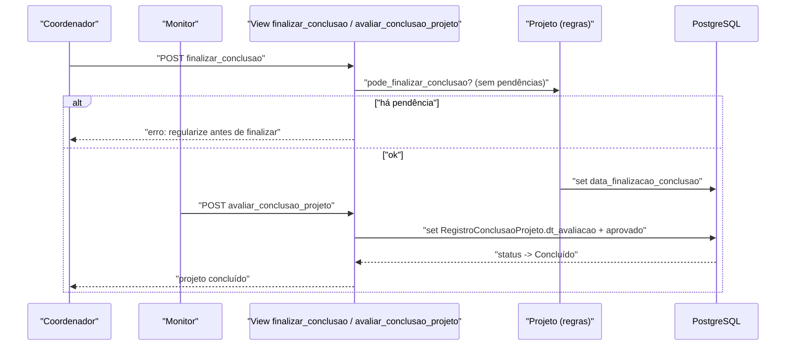

# Fluxo: Concluir projeto

> Sem pendências, o coordenador finaliza a conclusão e o monitor valida o registro de conclusão, encerrando o projeto.

- **Ator(es):** Coordenador do projeto (finaliza) + Monitor (avalia a conclusão) — ver [README → Atores e papéis](../README.md#atores-e-papéis)
- **Gatilho:** `POST /projetos_ensino/finalizar_conclusao/<projeto_id>/` (precedido de `registro_conclusao`) e `POST /projetos_ensino/avaliar_conclusao_projeto/<registro_id>/`
- **Pré-condições:** `Projeto.pode_finalizar_conclusao()` — existe `RegistroConclusaoProjeto` não avaliado e **nenhuma** pendência (execução de atividades, gastos, anexos, fotos, caracterização, lições, avaliação de aluno); usuário é o responsável.
- **Pós-condições:** `data_finalizacao_conclusao` preenchida; após o monitor avaliar o `RegistroConclusaoProjeto` (`dt_avaliacao`), o status passa a "Concluído"; participantes podem emitir certificados/declarações.
- **Depende de:** [Executar e monitorar projeto](executar-monitorar-projeto.md)
- **Habilita:** _nenhum_ (fim do ciclo; gestor pode `reabrir_projeto` se necessário)
- **Entrada no código:** views `finalizar_conclusao` (`views.py:2252`), `registro_conclusao` (`views.py:892`), `avaliar_conclusao_projeto` (`views.py:1946`)

## Sequência

## Observações

- O conjunto de pendências é centralizado em `Projeto.tem_pendencias()` e nas checagens `tem_registro_*_pendente`.
- Projeto concluído habilita `pode_emitir_certificado_de_participacao` / `pode_emitir_declaracao_*` para os participantes.
- `pode_reabrir_projeto()` permite ao gestor reabrir um projeto finalizado (não cancelado).

---
_Gerado/atualizado via subagent `documentador` em 2026-06-19._
