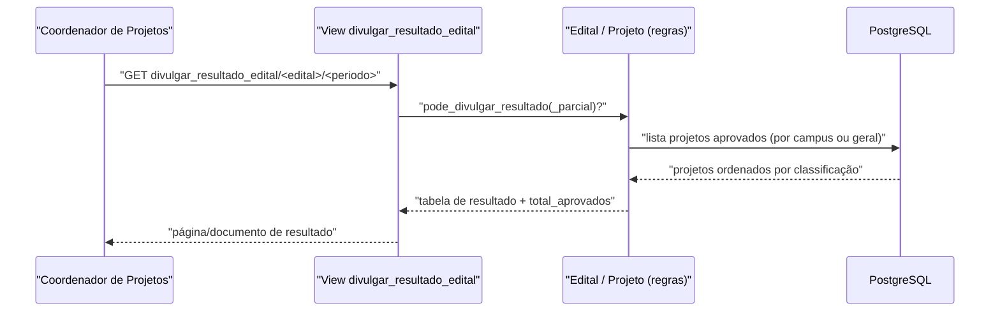

# Fluxo: Divulgar resultado

> O resultado da seleção (parcial ou final) é divulgado, tornando público quais projetos foram selecionados e abrindo a fase de execução / interposição de recursos.

- **Ator(es):** Coordenador de Projetos de Ensino / sistema — ver [README → Atores e papéis](../README.md#atores-e-papéis)
- **Gatilho:** `GET /projetos_ensino/resultado_edital/<periodo>/` (lista) e `GET /projetos_ensino/divulgar_resultado_edital/<edital_id>/<periodo>/` (documento de resultado)
- **Pré-condições:** `periodo=1` (final): `Edital.pode_divulgar_resultado()` (`divulgacao_selecao <= hoje` e `fim_selecao < hoje`); `periodo=2` (parcial): `pode_divulgar_resultado_parcial()` (`hoje <= divulgacao_selecao` e `fim_selecao < hoje`).
- **Pós-condições:** Listagem dos projetos `pre_aprovado=True, aprovado=True` agrupados por campus (forma `CAMPUS`) ou geral (`GERAL`), ordenados por classificação/pontuação; participantes passam a ver "Selecionado". Após `divulgacao_selecao`, projetos selecionados entram em execução.
- **Depende de:** [Avaliar e selecionar projeto](avaliar-selecionar-projeto.md)
- **Habilita:** [Executar e monitorar projeto](executar-monitorar-projeto.md); interposição de recurso (`enviar_recurso`, habilitado por `Projeto.pode_enviar_recurso`)
- **Entrada no código:** views `resultado_edital` (`views.py:3348`) e `divulgar_resultado_edital` (`views.py:3368`)

## Sequência

## Observações

- O total de aprovados exclui projetos que tiveram a vaga repassada via `ProjetoCancelado.proximo_projeto`.
- O cabeçalho usa `Configuracao.get_valor_por_chave('projetos_ensino', 'nome_proen')` e `('comum', 'instituicao')`.
- > ⚠️ REVISAR (segurança): `divulgar_resultado_edital` tem **apenas `@rtr()`**, sem `@permission_required` — qualquer usuário autenticado acessa o resultado, diferente de `resultado_edital` (gated por `pode_interagir_com_projeto`). Ver [HLA §7](../HLA.md#7-riscos-e-débito-técnico).

---
_Gerado/atualizado via subagent `documentador` em 2026-06-19._
