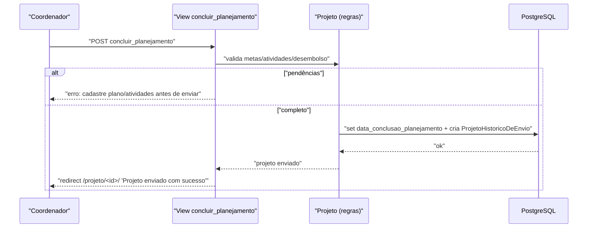

# Fluxo: Enviar projeto

> O coordenador conclui o planejamento e envia o projeto ao edital, tornando-o elegível à pré-seleção.

- **Ator(es):** Coordenador do projeto — ver [README → Atores e papéis](../README.md#atores-e-papéis)
- **Gatilho:** `POST /projetos_ensino/concluir_planejamento/<projeto_id>/`
- **Pré-condições:** Projeto em "Em edição" com o coordenador autenticado (`tem_permissao`); plano de aplicação + desembolso cadastrados (quando o edital tem recursos), metas com pelo menos uma atividade cada.
- **Pós-condições:** `data_conclusao_planejamento` preenchida; status passa a "Enviado" (`STATUS_INSCRITO`); registra `ProjetoHistoricoDeEnvio(situacao=ENVIADO)`; projeto entra na fila de pré-seleção.
- **Depende de:** [Submeter projeto](submeter-projeto.md)
- **Habilita:** [Pré-selecionar projeto](pre-selecionar-projeto.md)
- **Entrada no código:** view `concluir_planejamento` (`views.py:2200`)

## Sequência

## Observações

- Para editais `ENSINO_CONTINUO` a exigência de desembolso/plano de aplicação é dispensada (`tem_desembolso = tem_plano_aplicacao = True`).
- Se `vinculo_coordenador` estiver vazio, é preenchido com o participante responsável.
- O envio é o marco que separa "edição" de "avaliação": após enviado, a edição fica limitada (`eh_somente_leitura`).

---
_Gerado/atualizado via subagent `documentador` em 2026-06-19._
