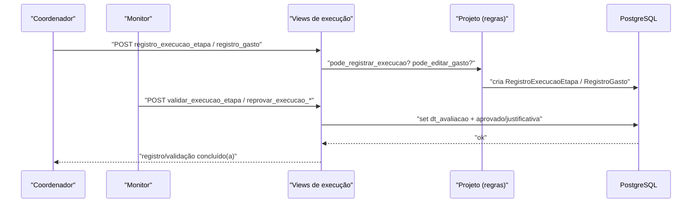

# Fluxo: Executar e monitorar projeto

> Durante a execução, o coordenador registra atividades, gastos, frequência e fotos; o monitor valida cada registro.

- **Ator(es):** Coordenador do projeto (registra) + Monitor (`pode_monitorar_projeto`, valida) — ver [README → Atores e papéis](../README.md#atores-e-papéis)
- **Gatilho:** Registros do coordenador (`registro_execucao_etapa`, `registro_gasto`, `cadastrar_frequencia`, `adicionar_foto`, `registro_beneficiario_atendido`) e validações do monitor (`validar_execucao_etapa`, `avaliar_conclusao_projeto`, `validar_frequencia`).
- **Pré-condições:** Projeto `STATUS_EM_EXECUCAO` (selecionado + após `divulgacao_selecao`, não inativado/cancelado/concluído); usuário é responsável (registro) ou monitor (validação). Regras em `Projeto.pode_registrar_execucao()`, `pode_editar_gasto()`.
- **Pós-condições:** `RegistroExecucaoEtapa`/`RegistroGasto`/`RegistroFrequencia`/`FotoProjeto` criados e avaliados (`dt_avaliacao`, `aprovado`); avança o percentual de execução/avaliação do projeto.
- **Depende de:** [Divulgar resultado](divulgar-resultado.md)
- **Habilita:** [Concluir projeto](concluir-projeto.md)
- **Entrada no código:** views `registro_execucao_etapa` (`views.py:966`), `registro_gasto` (`views.py:909`), `validar_execucao_etapa`, `avaliar_conclusao_projeto`, `cadastrar_frequencia`/`validar_frequencia`

## Sequência

## Observações

- A frequência de bolsistas tem validação de cobertura mensal (`Projeto.tem_frequencia_aluno_pendente`).
- A caracterização exige informar `quantidade_atendida` (`tem_caracterizacao_pendente`).
- Avaliação dos alunos (`AvaliacaoAluno`) só é exigida se `Edital.exige_avaliacao_aluno`; lições aprendidas se `exige_licoes_aprendidas`.
- Alterações de período de execução são registradas em `HistoricoAlteracaoPeriodoProjeto`.

---
_Gerado/atualizado via subagent `documentador` em 2026-06-19._
