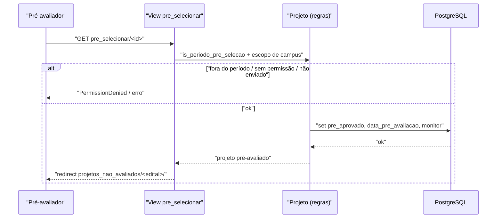

# Fluxo: Pré-selecionar projeto

> O pré-avaliador do campus faz a triagem dos projetos enviados, pré-aprovando ou pré-rejeitando dentro do limite da oferta.

- **Ator(es):** Pré-avaliador / Coordenador de Projetos de Ensino — ver [README → Atores e papéis](../README.md#atores-e-papéis)
- **Gatilho:** `GET /projetos_ensino/pre_selecionar/<projeto_id>/` (também `pre_aprovar`, `pre_rejeitar`, `pre_avaliacao`)
- **Pré-condições:** Edital em período de pré-seleção (`Edital.is_periodo_pre_selecao()`); projeto enviado (`data_conclusao_planejamento`); usuário é o autor da pré-avaliação ou coordenador de projetos com o campus atribuído (`CampusAdicional.get_campi_user`); para pré-aprovar, `Projeto.pode_pre_aprovar()` (vaga na oferta).
- **Pós-condições:** `pre_aprovado` definido (True/False), `data_pre_avaliacao` registrada, `vinculo_autor_pre_avaliacao`/`vinculo_monitor` setados. Em edital `ENSINO_CONTINUO`, a pré-aprovação já define `aprovado` (não há fase de seleção por nota).
- **Depende de:** [Enviar projeto](enviar-projeto.md)
- **Habilita:** [Avaliar e selecionar projeto](avaliar-selecionar-projeto.md) (edital `ENSINO`); ou diretamente [Executar e monitorar projeto](executar-monitorar-projeto.md) (edital `ENSINO_CONTINUO`)
- **Entrada no código:** view `pre_selecionar` (`views.py:2140`), `pre_aprovar`/`pre_rejeitar` (`views.py:1271`/`1277`)

## Sequência

## Observações

- A tela `pre_avaliacao` lista os projetos enviados; as ações disponíveis vêm de `Projeto.pode_ser_pre_aprovado()`/`pode_ser_pre_rejeitado()`/`pode_devolver_projeto()`.
- `pode_pre_aprovar()` respeita `OfertaProjeto.qtd_aprovados` por campus.
- Em `ENSINO_CONTINUO`, uma vez pré-avaliado o projeto não pode mais ser pré-avaliado (decisão definitiva).

---
_Gerado/atualizado via subagent `documentador` em 2026-06-19._
