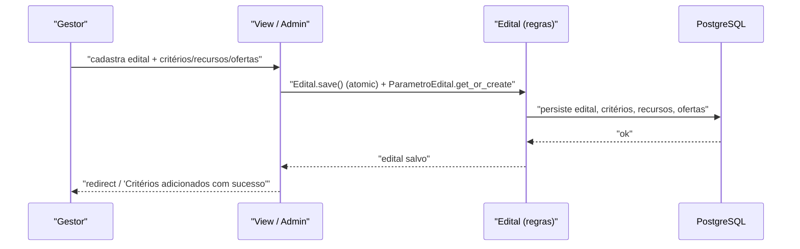

# Fluxo: Publicar edital

> O gestor cria um edital de ensino com calendário, critérios, recursos e ofertas, abrindo o período de submissão de projetos.

- **Ator(es):** Gerente Sistêmico de Projetos de Ensino / Coordenador de Projetos de Ensino — ver [README → Atores e papéis](../README.md#atores-e-papéis)
- **Gatilho:** Cadastro do `Edital` no admin (`/admin/projetos_ensino/edital/`) e definição dos critérios pontuáveis em `/projetos_ensino/edital/<edital_id>/`, mais recursos (`adicionar_recurso`), ofertas por campus (`adicionar_oferta_projeto`), critérios de avaliação (`adicionar_criterio_avaliacao`) e anexos.
- **Pré-condições:** Usuário com `pode_gerenciar_edital`/`view_edital`; cadastros de apoio (Eixo Temático, Tipo de Beneficiário, Critério) existentes.
- **Pós-condições:** `Edital` com calendário completo; ao entrar `inicio_inscricoes <= hoje <= fim_inscricoes`, o edital aparece em "Inscrições abertas" e em `editais_abertos`.
- **Depende de:** _nenhum_
- **Habilita:** [Submeter projeto](submeter-projeto.md)
- **Entrada no código:** admin `EditalAdmin` + view `edital` (`views.py:422`), `EditalManager.em_inscricao()`

## Sequência

## Observações

- O acesso a um edital específico passa por `tem_permissao_acesso_edital` (gestor, ou quem cadastrou/tem oferta no campus).
- `Edital.get_form()` monta dinamicamente os campos a partir dos `Parametro` cadastrados, agrupados por `grupo`.
- A `OfertaProjeto` por campus define `qtd_aprovados` (pré-selecionados) e `qtd_selecionados` — usados na pré-seleção e na seleção.

---
_Gerado/atualizado via subagent `documentador` em 2026-06-19._
